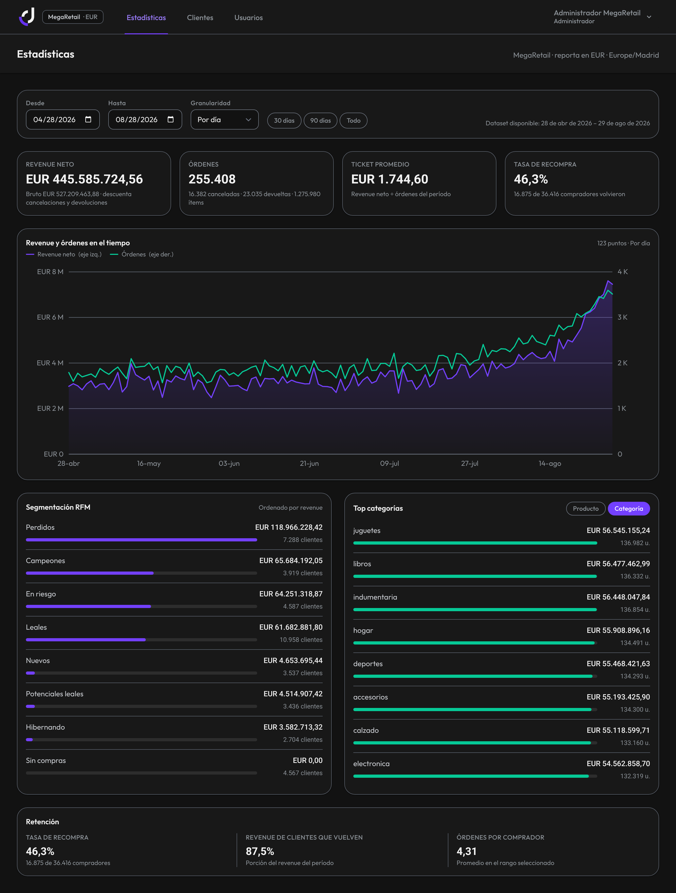
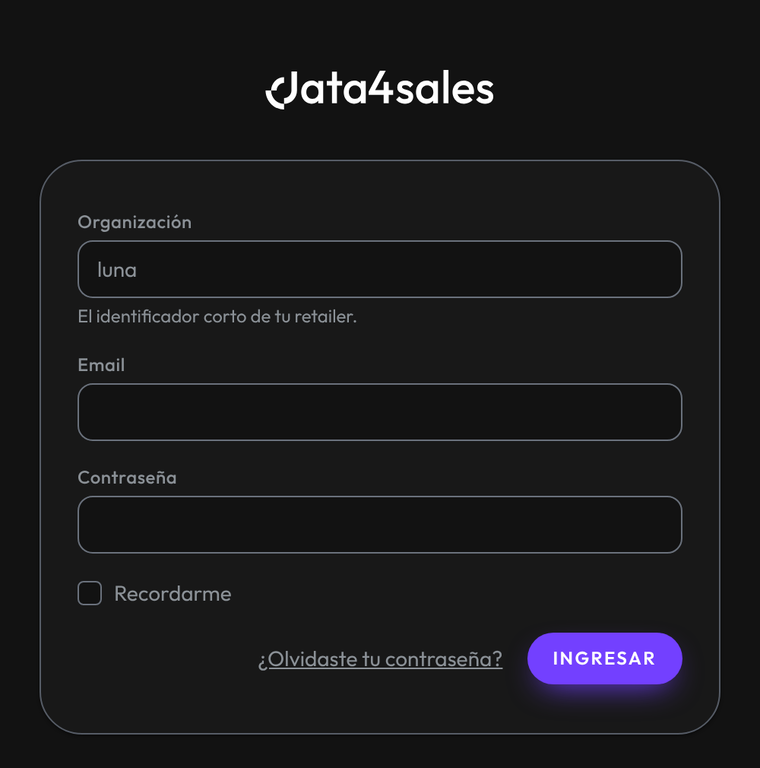
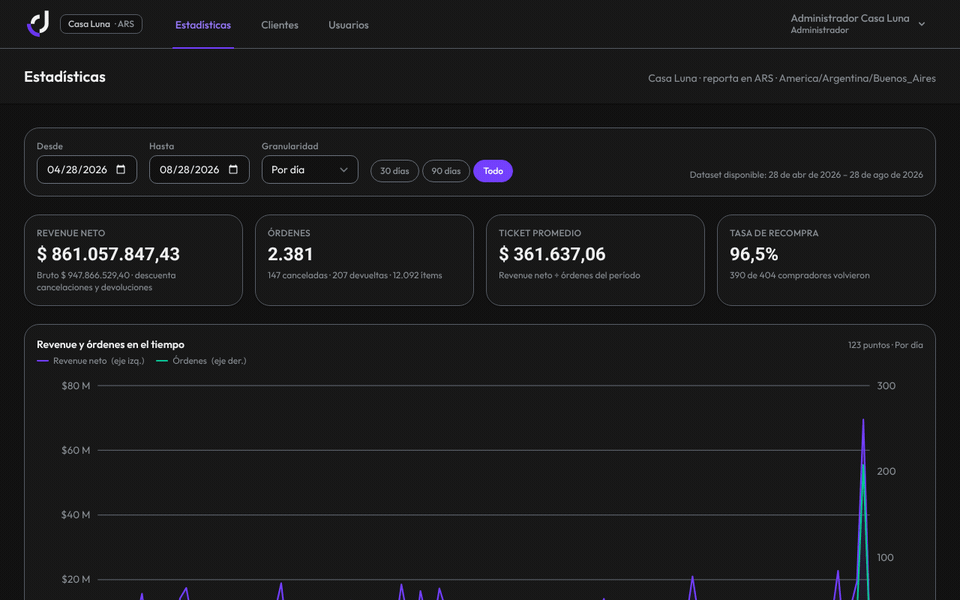
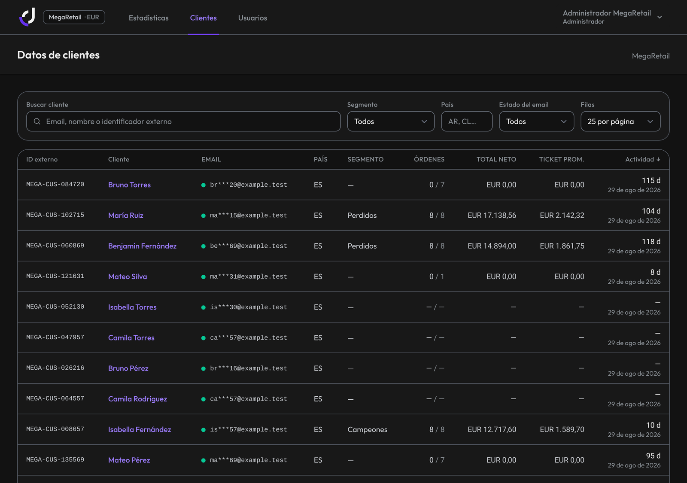
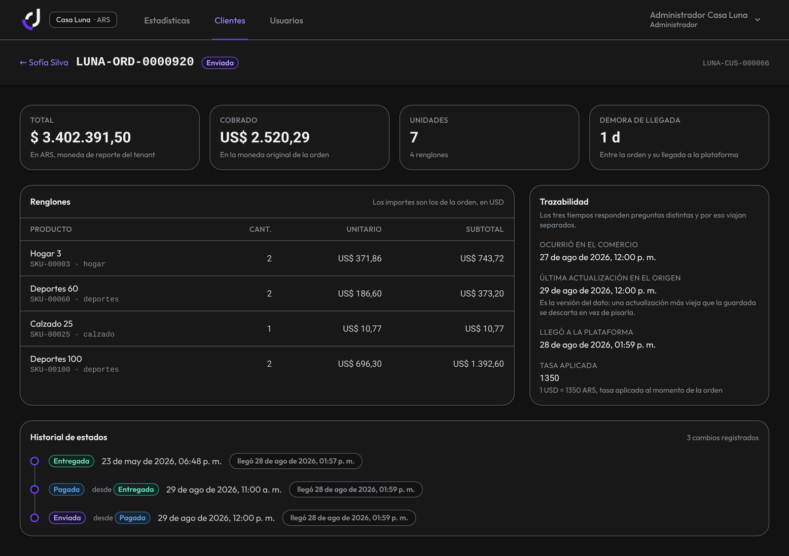
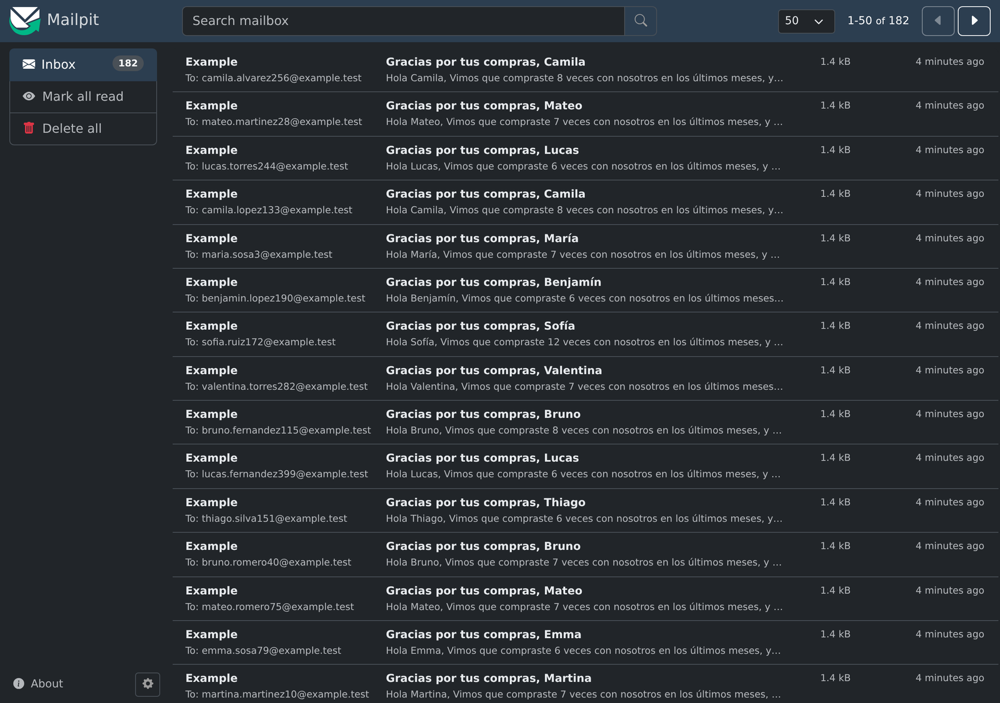
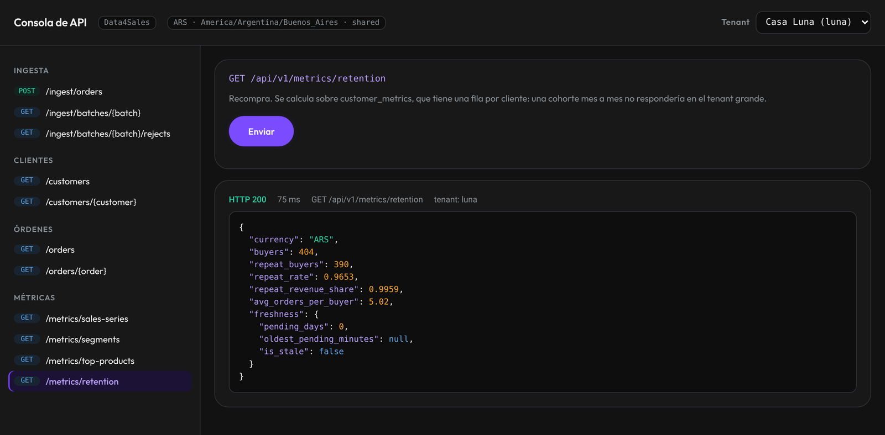
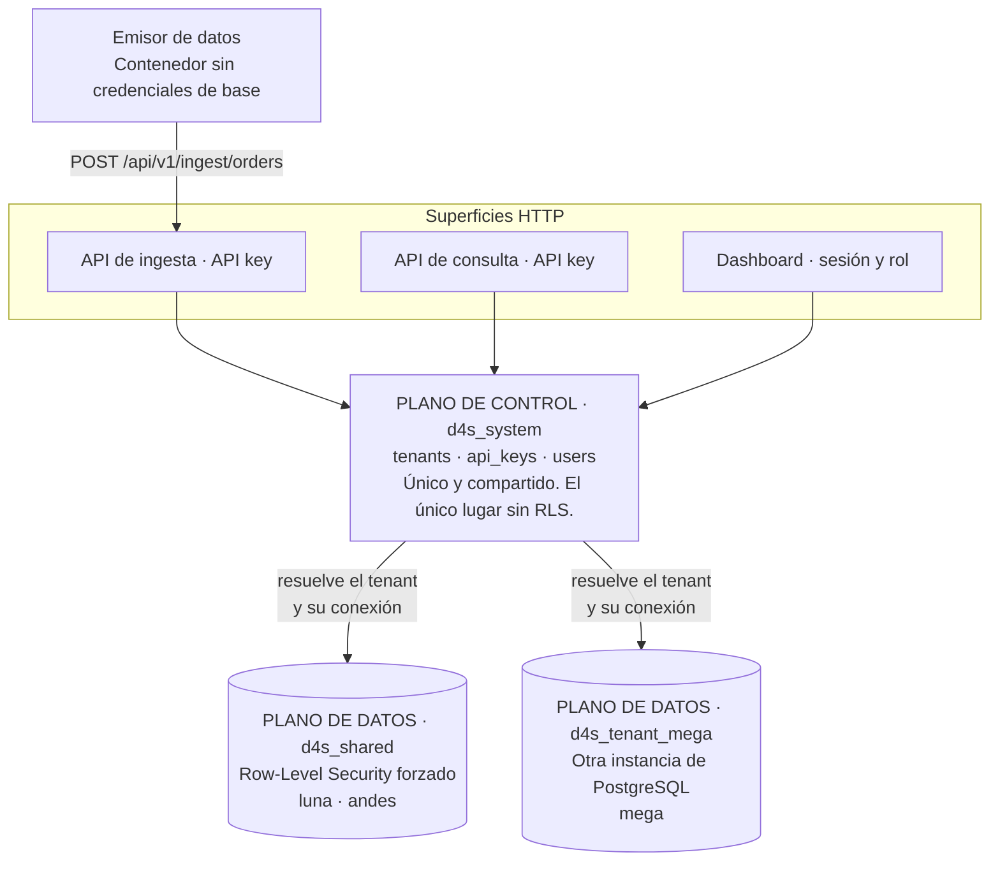

# Data4Sales — Prueba técnica Fullstack Senior

Plataforma B2B multi-tenant que ingesta las ventas de un retailer, las expone
en un dashboard operativo y permite accionar sobre sus compradores.

**Las tres partes están entregadas y funcionando.** La Parte 3 incluye el diseño
completo con diagramas y el recorte vertical que el enunciado ofrece como puntos
extra: una condición resuelta contra el dataset real, con los correos saliendo
contra Mailpit.



<sub>MegaRetail, el tenant de base dedicada: 255.651 órdenes reales del emisor.
Todos los datos de este README y de sus capturas son sintéticos.</sub>

| Si querés… | Andá a |
|---|---|
| levantarlo con datos, con un comando | [1 · Cómo levantarlo](#1-cómo-levantarlo) |
| saber qué **no** está y por qué | [4 · Limitaciones conocidas](#4-limitaciones-conocidas) |
| ver qué hace con los datos sucios | [5 · Cada tipo de suciedad](#5-qué-hace-el-sistema-con-cada-tipo-de-suciedad) |
| verificar el aislamiento vos mismo | [8 · Aislamiento](#8-cómo-verificar-el-aislamiento-entre-tenants) |
| entender **por qué** está hecho así | [DECISIONS.md](DECISIONS.md) — 35 decisiones |

<details>
<summary>Índice completo</summary>

1. [Cómo levantarlo](#1-cómo-levantarlo)
2. [Cómo cargar más dataset](#2-cómo-cargar-más-dataset)
3. [Credenciales](#3-credenciales)
4. [Limitaciones conocidas](#4-limitaciones-conocidas)
5. [Qué hace el sistema con cada tipo de suciedad](#5-qué-hace-el-sistema-con-cada-tipo-de-suciedad)
6. [Estado de la entrega](#6-estado-de-la-entrega)
7. [Escala: lo que está medido](#7-escala-lo-que-está-medido)
8. [Cómo verificar el aislamiento entre tenants](#8-cómo-verificar-el-aislamiento-entre-tenants)
9. [La API: contrato y consola](#9-la-api-contrato-y-consola)
10. [Arquitectura y dónde está cada cosa](#10-arquitectura-y-dónde-está-cada-cosa)
11. [Tests y análisis estático](#11-tests-y-análisis-estático)
12. [Qué haría distinto con otra semana](#12-qué-haría-distinto-con-otra-semana)
13. [Uso de IA](#13-uso-de-ia)

</details>

---

## 1. Cómo levantarlo

Requiere Docker con Compose v2. No hace falta nada más instalado: ni PHP, ni
Composer, ni Node.

```bash
docker compose up -d
```

Eso es todo, y **eso incluye los datos**. El servicio `init` migra los tres
planos y siembra tenants, usuarios y claves; después el servicio `dataset`
espera a que la API responda y le empuja unas 13.600 órdenes repartidas entre
los tres tenants.

**No hay un segundo comando que correr.** La carga sigue por detrás después de
que la terminal vuelve, y las pantallas se van llenando solas: en un arranque
en frío medido de punta a punta tardó unos diez minutos hasta quedar completa,
con datos visibles bastante antes. Para seguirla:

```bash
docker compose logs -f dataset
```

La carga entra por la API pública con una API key, igual que lo haría el
retailer. No es un atajo por debajo: es la misma regla del enunciado
ejercitándose en el arranque del propio producto.

Lo que queda cargado: **13.617 órdenes** (7.991 entre `luna` y `andes`, 5.626 en
`mega`), 4.902 clientes y 920 registros rechazados, que son los que le dan
conteos reales a la tabla de la [sección 5](#5-qué-hace-el-sistema-con-cada-tipo-de-suciedad).

| Servicio | URL | Para qué |
|---|---|---|
| Dashboard | http://localhost:8080 | La aplicación web |
| **Consola de API** | http://localhost:8080/api-console | Explorar y probar la API a mano |
| Mailpit | http://localhost:8025 | Correo local (Parte 3) |
| Postgres compartido | `localhost:5432` | Plano de control + datos de tenants `shared` |
| Postgres dedicado | `localhost:5433` | Datos de los tenants con base propia |

```bash
docker compose logs init                      # qué hizo la instalación
docker compose down -v && docker compose up -d  # empezar de cero, borrando todo
```

---

## 2. Cómo cargar más dataset

El arranque ya carga un dataset de trabajo (sección 1). Esta sección es para
cargar **más**, o para ejercitar los modos que el arranque no usa: el flujo
diario, el envío que se corta a la mitad, o subir el volumen del tenant grande.

El emisor corre en su propio contenedor y empuja los datos contra la API.
**No tiene credenciales de base de datos**: mirá el servicio `emitter` en
`docker-compose.yml` y vas a ver que no recibe ni host, ni usuario, ni
contraseña de PostgreSQL. Es la prueba estructural de que la API es el único
punto de entrada — no depende de que alguien respete la regla.

```bash
# Carga inicial de un retailer que recién se integra (4 meses de historia)
docker compose run --rm emitter php artisan d4s:emit --tenant=luna  --orders=2500
docker compose run --rm emitter php artisan d4s:emit --tenant=andes --orders=6000
docker compose run --rm emitter php artisan d4s:emit --tenant=mega  --orders=6000

# Flujo del día a día: ventas nuevas, actualizaciones de estado y datos tardíos
docker compose run --rm emitter php artisan d4s:emit --tenant=luna --mode=daily --orders=400

# Un envío que se corta a la mitad
docker compose run --rm emitter php artisan d4s:emit --tenant=luna --orders=500 --interrupt
```

El generador es **reproducible**: con la misma semilla produce exactamente el
mismo dataset, registro por registro. La semilla se deriva del slug del tenant,
así que volver a correr el mismo comando reenvía los mismos datos — y como las
claves de idempotencia también son deterministas, el sistema los reconoce y no
duplica nada.

Los ejemplos usan 6000 órdenes para que la carga termine en un par de minutos.
Subir `--orders` es todo lo que hace falta para llevarlo más arriba; el cuello
de botella medido es la generación y el envío en PHP, no el almacenamiento.
Cuánto hay cargado hoy y qué se midió sobre ese volumen está en
[§7 Escala](#7-escala-lo-que-está-medido).

<details>
<summary><b>Para cargar en paralelo hay que repartir el rango, no cambiar la semilla</b></summary>

Es una trampa que conviene saber antes de caer en ella, porque el síntoma es
silencioso. Lanzar el *mismo* comando en varios procesos **no carga más datos**:
el identificador de orden es `TENANT-ORD-{n}` con `n` corriendo desde 1, así que
los N procesos generan el mismo rango de identificadores y el sistema deduplica
todo menos el primero. Cambiar `--seed` **no** lo arregla: la semilla cambia el
contenido de las órdenes, no su identificador.

Pasó acá mientras se preparaba el entorno, y quedó como evidencia de que la
idempotencia funciona: ocho procesos mandaron 249.864 eventos crudos y el sistema
guardó exactamente los identificadores distintos que había en juego, una fracción
de lo enviado. Ni un duplicado entró, y ninguno de los ocho procesos falló.

Lo que sí reparte una carga es `--offset`:

```bash
# Cuatro procesos, cuatro tramos que no se pisan.
for off in 0 50000 100000 150000; do
  docker compose run --rm --no-deps -T emitter php artisan d4s:emit \
    --tenant=mega --orders=50000 --offset=$off --batch=1000 --no-wait &
done
wait
```

El desplazamiento entra también en la clave de idempotencia del lote. Sin eso,
dos procesos que comparten tenant, semilla y numeración de lote mandarían las
mismas claves, y el servidor tomaría los lotes del segundo como reintentos del
primero: descartaría la mitad de los datos sin un solo error visible.

</details>

---

## 3. Credenciales

Todas son de desarrollo, deterministas y están en el repositorio a propósito
para que el sistema se pueda evaluar sin configurar nada.

**Contraseña para todos los usuarios: `password`**

El login pide **organización + email + contraseña**, en ese orden. El email no es
un identificador global: el índice único es `(tenant_id, email)`, igual que Slack
pide el workspace antes que el usuario. La razón está en
[D-08](DECISIONS.md#d-08--el-email-no-identifica-a-un-cliente). La "organización"
es el slug del tenant.




| Tenant | Slug | Rol en el diseño | Aislamiento | Usuarios |
|---|---|---|---|---|
| Casa Luna | `luna` | el chico | compartido | `analyst@luna.test` · `support@luna.test` · `admin@luna.test` |
| Andes Sport | `andes` | el mediano | compartido | `analyst@andes.test` · `support@andes.test` · `admin@andes.test` |
| MegaRetail | `mega` | el grande | **base propia** | `analyst@mega.test` · `support@mega.test` · `admin@mega.test` |

Los tres difieren además en zona horaria (Buenos Aires, Santiago, Madrid) y
moneda de reporte (ARS, USD, EUR), para que los bordes de fecha y de conversión
se ejerciten de verdad en vez de quedar como código muerto.

"Chico", "mediano" y "grande" son el **rol que cada tenant juega en el diseño**
—quién comparte base y quién tiene la suya—, no el volumen que hay adentro. Los
volúmenes reales están en [§7](#7-escala-lo-que-está-medido).

### API keys

```
luna   d4s_dev_luna_8d6eebb6b52cce5e4a5c8e0711d9197fa6df1c617d151942887510a23d39ebf0
andes  d4s_dev_andes_821daeb5b6b9d367dc7a9dba45cc66f050a03a3aacc675e7cc31ca45250c9882
mega   d4s_dev_mega_e2e9b11fccd050127f975d47f3c0b215e6a58adbef8a6bee791da69383f8dc94
```

---

## 4. Limitaciones conocidas

Sección de lectura obligatoria, según el enunciado. Es honesta: lo que no está,
está acá, y lo que está a medias dice hasta dónde llega.

### Alcance funcional

- **Sólo se normalizan órdenes.** Los lotes de `customers` y `products` sueltos
  quedan en la zona cruda y se reportan como **rechazados** (`unsupported_entity`).
  Los retailers mandan la venta completa con comprador y renglones anidados, así
  que ese camino cubre el caso real. Contarlos como aceptados mentiría: «aceptado»
  significa que el registro llegó a la zona curada, y esos no llegan.
- **El modo por reglas del motor de acciones no está implementado.** Está diseñado;
  el recorte implementa el modo de conjunto estático. Los operadores `or`, `not` y
  `purchased` se rechazan **por nombre**: un motor que acepta un `or` y lo compila
  mal es peor que uno que dice «todavía no».
- **No hay interfaz web de campañas.** Los comandos cubren el flujo completo; una
  pantalla no demuestra nada más del motor.
- **Las tasas de cambio son una tabla fija.** Lo que **no** es una simplificación es
  el diseño: la tasa se resuelve con la fecha de la orden y queda guardada en la
  fila, así que el número es reproducible y auditable.
- **La validación de email exige ASCII.** Rechaza direcciones internacionalizadas,
  igual que `filter_var`. El costo es acotado: el comprador se conserva con el email
  marcado como inválido, no se pierde.
- **Nada impide dejar una organización sin administradores.** Un administrador no
  puede desactivarse a sí mismo, pero sí bajar al último otro. La regla completa
  exige contarlos dentro de una transacción; el caso propio cubre el riesgo más
  frecuente.

### Operación y datos

- **La red de seguridad del recómputo corre cada cinco minutos, no al instante.**
  El camino feliz es que la ingesta encole el recómputo al terminar cada lote; el
  servicio `scheduler` cubre el infeliz —un worker que muere después de marcar los
  días sucios— con un peor caso de cinco minutos. El campo `freshness` de las
  métricas lo hace visible mientras tanto.
- **La zona cruda no tiene política de retención.** Guardar el payload original de
  millones de órdenes crece sin techo. Identificado, no resuelto.
- **La paginación es por cursor, no por página.** `OFFSET 50000` obliga al motor a
  contar y descartar cincuenta mil filas antes de devolver nada. El costo es que no
  hay "ir a la página 7", que en una pantalla de soporte no le sirve a nadie.
- **La pantalla de estadísticas carga todo el rango de una vez.** Con cuatro meses
  son ~120 puntos y responde bien. Con dos años de historia diaria habría que
  paginar la serie o subir la granularidad por defecto.
- **Migrar los tenants dedicados es un recorrido secuencial.** Con uno es trivial;
  si esa porción creciera haría falta un orquestador con versión por tenant.

### Seguridad y recursos

- **El límite de tasa es por credencial, no una cuota por tenant.** `/api/v1/*`
  tiene techo —300 peticiones por minuto en ingesta, 120 en consulta, aplicadas
  **antes** de autenticar, así que también alcanzan a quien prueba claves al azar—
  pero no hay cuota de **recursos**: dos credenciales del mismo retailer dan el
  doble de cupo. El aislamiento de **datos** lo garantiza el motor; el de recursos,
  no.
- **Los usuarios del dashboard no están protegidos por RLS.** Viven en el plano de
  control, que debe ser consultable antes de conocer el tenant. Un fallo de scoping
  podría exponer el listado de empleados de otro tenant. El dato personal de
  compradores está todo en el plano de datos, que sí protege el motor.
- **Las credenciales de base están en el compose, en claro.** Es un entorno de
  evaluación. La tabla de tenants ya está diseñada para un gestor de secretos:
  guarda el nombre lógico de la conexión, nunca un DSN.
- **`APP_DEBUG` está en `false`** también en local, a propósito: la API recibe input
  no confiable y un stack trace filtra estructura interna.

---

## 5. Qué hace el sistema con cada tipo de suciedad

Esta tabla sale de un comando, no de la memoria de nadie:

```bash
docker compose exec app php artisan d4s:dirt-table --tenant=luna --markdown
```

La columna **Observado** son los rechazos reales del dataset de `luna` con 2500
órdenes de carga inicial más 400 de flujo diario.

| Suciedad | Detalle | Qué hace el sistema | Observado |
|---|---|---|---:|
| Registro duplicado exacto | El mismo registro llega dos veces, idéntico byte por byte. | Índice único sobre (tenant_id, hash del contenido canonicalizado). Lo resuelve el motor de forma atómica: dos workers en paralelo no pueden insertarlo dos veces. Se cuenta como duplicado en el lote y no se reprocesa. | — |
| Duplicado parcial | Mismo identificador de origen, contenido distinto. | No es un duplicado sino una actualización. Upsert sobre (tenant_id, external_id) con guarda de versión: gana el evento con `source_updated_at` más nuevo, sin importar el orden de llegada. | — |
| Dato que llega tarde | Una orden de hace dos meses aparece en el envío de hoy. | Se acepta con normalidad. Se guardan por separado `placed_at` (cuándo ocurrió) y `received_at` (cuándo llegó), y el día afectado se marca en `aggregate_dirty_days` para que un trabajo recalcule sólo ese día. El retraso es medible en el campo `freshness` de las métricas. | — |
| Dos o más monedas | El mismo tenant vende en distintas monedas. | Se conserva el monto en su moneda original y se agrega el equivalente en la moneda de reporte, con la tasa del día de la orden congelada en la fila. Nunca se convierte al vuelo. | — |
| Fechas en distintos formatos y zonas | ISO con offset, epoch, formato latino, o sin zona horaria. | Se prueban varios formatos. Si la fecha no trae zona, se interpreta en la del TENANT y no en la del servidor: una venta a las 22:30 en Buenos Aires se cuenta ese día, no el siguiente. | — |
| Emails repetidos entre clientes distintos | Dos compradores comparten casilla. | Se acepta sin observaciones. El email es dato de contacto, no identidad: el índice sobre `email_normalized` NO es único, a propósito. Familias que comparten casilla y cuentas corporativas son casos reales. | — |
| Envío que se interrumpe a mitad de camino | Llegan menos registros de los que el emisor anunció. | El lote queda en estado `partial` con la cuenta exacta de lo recibido. Como la zona cruda es append-only y la normalización es idempotente, reenviar el lote completo es seguro: lo ya ingerido se cuenta como duplicado y no entra dos veces. | — |
| Falta un campo obligatorio | `missing_field` | Se descarta el registro y se anota el campo faltante. El resto del lote sigue. | 33 |
| Campo obligatorio presente pero vacío | `empty_field` | Cadena vacía y sólo-espacios se normalizan a nulo. Si el campo era obligatorio, se descarta el registro. | 20 |
| Campo con tipo o formato inesperado | `invalid_type` | Se intenta coerción tolerante (por ejemplo "1.234,56" a entero). Si no se puede, se descarta el registro. | 34 |
| El registro declara pertenecer a otro tenant | `foreign_tenant` | Se descarta el registro. Además, la política WITH CHECK de PostgreSQL rechazaría el INSERT aunque esta validación fallara. | 12 |
| El registro no trae identificador de origen | `missing_identifier` | Se descarta: sin identificador de origen no hay forma de deduplicar ni de actualizar después. | 13 |
| Monto negativo o no numérico | `invalid_amount` | Se descarta el registro. Un monto inválido contamina todos los agregados que lo toquen. | 17 |
| Moneda que no es un código ISO-4217 conocido | `unknown_currency` | Se descarta el registro. Convertirlo con una tasa inventada sería peor que no tenerlo. | 16 |
| Estado de orden que no se puede mapear | `unknown_status` | Se descarta el registro. Antes se intenta mapear sinónimos habituales (complete, canceled, refunded). | 12 |
| Fecha en un formato que no se puede interpretar | `malformed_date` | Se prueban varios formatos y zonas horarias. Si ninguno interpreta, se descarta el registro. | 22 |
| Email que no pasa validación | `email_invalid` | Se CONSERVA el cliente con el email marcado como inválido. Se anota el rechazo a nivel de campo, no de registro. | 54 |
| Actualización más vieja que el estado ya guardado | `stale_update` | Se ignora la actualización y se conserva el estado más nuevo. Queda registrada en el historial para poder investigarla. | 49 |

> Ninguna fila marca cero. Una política documentada que nunca se ejecuta es peor
> que no tenerla, así que el generador inyecta deliberadamente cada uno de estos
> casos y la tabla lo demuestra con conteos.

<details>
<summary>Cómo se genera esta tabla, y qué parte de ella puede envejecer</summary>

**Las 11 filas de motivos de rechazo se generan desde el código.** Salen de
recorrer `RejectReason`, el enum que el pipeline usa para clasificar cada registro
que descarta: el texto de cada fila son sus métodos `describesDirt()` y
`describesPolicy()`, y la columna Observado son los conteos reales de
`ingestion_rejects`. Esas once no pueden quedar desactualizadas sin que el código
cambie primero: agregar un motivo agrega una fila sola.

**Las 7 filas restantes están escritas a mano**, en la constante
`NON_REJECT_CASES` de `DirtTableCommand`. Son las que describen suciedad que **no
termina en el rechazo de un registro** —un duplicado exacto, una actualización que
llega desordenada, una venta con fecha vieja, un envío cortado a la mitad—, así
que no hay un `RejectReason` del que derivarlas ni un conteo que mostrar: van con
`—` en Observado. Redactarlas a mano fue la decisión; el costo es que esas siete
sí pueden envejecer si la política cambia y nadie toca el comando.

</details>

---

## 6. Estado de la entrega



<sub>El recorrido que hace el producto: de lo agregado a lo individual, y de lo
individual a su trazabilidad.</sub>

| Parte | Qué se entregó | Dónde verlo |
|---|---|---|
| 1 · Ingesta | API asíncrona: valida el sobre, persiste el lote crudo, encola y responde **202** con el identificador del lote | [§9](#9-la-api-contrato-y-consola) |
| 1 · Normalización | Un stage testeado por cada tipo de suciedad | [§5](#5-qué-hace-el-sistema-con-cada-tipo-de-suciedad) |
| 1 · Consulta | Clientes con búsqueda, detalle con historial, órdenes filtrables, y las cuatro métricas agregadas que alimentan la Parte 2 | [`docs/openapi.yaml`](docs/openapi.yaml) |
| 1 · Emisor | Reproducible, con los dos modos que pide el enunciado | [§2](#2-cómo-cargar-más-dataset) |
| 1 · Agregados | La ingesta marca los días afectados y un trabajo recalcula sólo esos; `freshness` hace medible el desfasaje | [§7](#7-escala-lo-que-está-medido) |
| 1 · Aislamiento | Row-Level Security con las dos estrategias conviviendo | [§8](#8-cómo-verificar-el-aislamiento-entre-tenants) |
| 2 · Login | Por organización: slug del tenant, email y contraseña | [§3](#3-credenciales) |
| 2 · Roles | Las rutas declaran capacidades, no roles; hay tests que piden las URLs directamente | [§11](#11-tests-y-análisis-estático) |
| 2 · Estadísticas | Revenue y órdenes con selector de rango y granularidad, segmentación RFM, top de productos y categorías, recompra | `/estadisticas` |
| 2 · Datos de clientes | Búsqueda con índice trigrama, filtros, paginación por cursor, ficha con historial completo | `/clientes` |
| 2 · Detalle de orden | Renglones, tasa de cambio aplicada, los tres tiempos de la ingesta y el **historial de estados** completo | `/clientes/{id}/ordenes/{id}` |
| 2 · Gestión de usuarios | Sólo administradores, y sólo dentro de su organización | `/usuarios` |
| 3 · Diseño | El DSL, el compilador a SQL, los tres casos del enunciado resueltos, y los ocho diagramas | [`docs/parte-3-motor-de-acciones.md`](docs/parte-3-motor-de-acciones.md) |
| 3 · Recorte vertical | Una condición resuelta contra el dataset real, con los correos saliendo | abajo |



<sub>El email viaja **enmascarado** en el listado y completo en el detalle: un
listado se pagina, se exporta y se copia, y que no lleve contacto completo hace que
una fuga de mil filas no sea una fuga de mil contactos. El filtro de país aparece
porque MegaRetail tiene dos; con un solo país el control no filtraría nada y la
pantalla lo esconde.</sub>



<sub>La pantalla que mejor resume el proyecto. Los dos montos con la tasa que los
une, los tres tiempos separados, y un historial que llegó **fuera de orden
lógico** —entregada, después pagada, después enviada—: el campo `status` solo diría
«enviada» y no contaría nada de eso.</sub>

Tres criterios detrás de esa tabla, que importan más que el resultado:

- **Responder 201 sería mentir.** Entre «recibido» y «aceptado» hay una ventana, y
  el endpoint de estado del lote la hace observable.
- **El `tenant_id` va dentro de las credenciales de `Auth::attempt`**, no como
  filtro posterior: nunca existe un instante en el que un usuario del tenant
  equivocado quede autenticado.
- **Que el menú oculte un enlace es cortesía; el 403 lo tira el middleware.** El
  enunciado pide que no se pueda acceder «ni desde la interfaz ni por fuera de
  ella», y eso sólo lo garantiza el servidor.

### El recorte vertical de la Parte 3

```bash
docker compose exec app php artisan d4s:campaign:run luna gracias-frecuentes --dry-run
#  → Audiencia: N destinatarios · frescura de métricas: al día

docker compose exec app php artisan d4s:campaign:run luna gracias-frecuentes --send
#  → Congelados N-d · excluidos por email repetido d · enviados N-d
```

Los correos quedan en **http://localhost:8025**.



<sub>Una corrida real: 185 clientes cumplían la condición, 3 compartían dirección
de correo con otro cliente, y salieron 182. Esa resta es el diseño funcionando.</sub>

**Acá no hay números fijos a propósito.** La condición es "más de 3 compras en los
últimos 90 días": una ventana relativa a `now()`, así que el tamaño de la
audiencia depende del día en que se corra. Escribir un número exacto sería
prometer una salida que no se reproduce. Lo que sí es estable es la **relación**:
los que cumplen la condición, menos los que comparten dirección de correo, dan los
que reciben. Esa resta es el diseño funcionando — la deduplicación es por
dirección, no por cliente ([D-26](DECISIONS.md)).

Y la pregunta que el enunciado pide poder responder:

```bash
docker compose exec app php artisan d4s:campaign:explain luna {RUN} LUNA-CUS-000205
```

Devuelve dos bloques separados: **REGISTRADO** (entró, se generó la intención,
salió el correo) y **RECONSTRUIDO** (si cumple la condición, evaluado *ahora*,
cláusula por cláusula). La etiqueta importa: presentar una reconstrucción como si
fuera un registro es peor que no responder.

---

## 7. Escala: lo que está medido

**Una instalación nueva no arranca con estos números.** El servicio `dataset`
carga unas 13.600 órdenes repartidas entre los tres tenants, que alcanzan para
que todas las pantallas tengan qué mostrar en un par de minutos. La tabla de
abajo es la instancia sobre la que se tomaron las mediciones de esta sección,
cargada subiendo `--orders` en el emisor durante horas (sección 2). Se deja
para que se vea contra qué volumen corren los planes de consulta, no para
prometer lo que vas a encontrar al levantarlo.

| Tenant | Órdenes | Clientes | Base |
|---|---:|---:|---|
| `luna` | 2.381 | 404 | `d4s_shared` |
| `andes` | 118.682 | 12.004 | `d4s_shared` |
| `mega` | 255.651 | 122.403 | `d4s_tenant_mega` |

```bash
docker compose exec -T postgres-shared psql -U postgres -d d4s_shared \
  -c "SELECT count(*) FROM orders"            # luna + andes: 121.063
docker compose exec -T postgres-dedicated psql -U postgres -d d4s_tenant_mega \
  -c "SELECT count(*) FROM orders"            # mega: 255.651
```

Que `luna` y `andes` compartan base es lo que hace verificable el aislamiento: los
planes de abajo corren sobre una tabla que contiene además los datos de otro
tenant.

<details>
<summary>Desglose por tabla del tenant grande</summary>

| Tabla | Filas |
|---|---:|
| `order_items` | 639.359 |
| `raw_events` | 493.448 |
| `orders` | 255.651 |
| `customers` | 122.403 |
| `customer_metrics` | 40.996 |
| `daily_sales_facts` | 249 |

</details>

### Los tres accesos que sostienen el dashboard

Medidos con `EXPLAIN ANALYZE` sobre ese volumen:

| Consulta | Plan | Tiempo |
|---|---|---:|
| Serie temporal de revenue, 180 días | `Seq Scan` sobre 249 filas de `daily_sales_facts` | **0,29 ms** |
| Órdenes de un cliente, paginado | `Index Scan Backward` con `orders_tenant_id_customer_id_placed_at_index` | **0,10 ms** |
| Búsqueda por nombre, término frecuente sin `LIMIT` (peor caso) | `Bitmap Index Scan` sobre `customers_name_trgm_idx`, 10.482 coincidencias | **34 ms** |

Lo que muestran no es la velocidad, es **de qué depende**:

- La serie temporal tarda lo mismo con 255.651 órdenes que con 255 millones,
  porque no las lee: lee las 249 filas diarias que la ingesta mantiene al día. El
  agregado incremental es lo que hace que el dashboard no escale con el volumen
  del hecho. Ese es el argumento entero.
- El detalle de un cliente entra por `(tenant_id, customer_id, placed_at)`, así que
  el costo es el de las 25 filas devueltas, no el de la tabla.
- La búsqueda sí crece con el padrón, porque un `%texto%` es una búsqueda de
  subcadena: el índice trigrama la mantiene en decenas de milisegundos, pero es el
  acceso que primero pediría atención al crecer otro orden de magnitud.

### Por qué no se cargó más

El plan original era llegar a 240.000 órdenes en `mega` y 150.000 en `andes`. Se
llegó a 255.651 y 118.682, y **se cortó ahí a propósito**: cargar más no cambiaba
ninguna de las tres conclusiones de arriba. Los planes ya son los definitivos
—índice o agregado, nunca recorrido de la tabla de hechos— y un `Index Scan` sobre
diez millones de filas devuelve el mismo plan con un nivel más de árbol. Lo que sí
costaba era tiempo de máquina que hacía falta para cerrar agujeros de seguridad y
correctitud, que es donde el enunciado pone el peso.

Con una semana más el camino no sería cargar diez veces más en la misma forma,
sino particionar `orders` y `raw_events` por rango de fecha y medir el mismo juego
de consultas contra la tabla particionada ([§12](#12-qué-haría-distinto-con-otra-semana)).

---

## 8. Cómo verificar el aislamiento entre tenants

Es la garantía central del sistema, así que se puede comprobar a mano, contra el
motor, sin pasar por la aplicación:

```bash
docker compose exec -T -e PGPASSWORD=app_secret postgres-shared \
  psql -U d4s_app -d d4s_shared -c "SET row_security = off; SELECT count(*) FROM customers;"
```

La respuesta es un error: `query would be affected by row-level security policy
for table "customers"`. El rol de la aplicación **ni siquiera puede pedir** que se
desactive el aislamiento, porque no tiene `BYPASSRLS`.

Tres propiedades que vale la pena mirar en
[`RowLevelSecurity.php`](platform/app/Domain/Tenancy/Database/RowLevelSecurity.php):

1. **`FORCE ROW LEVEL SECURITY`** — en Postgres el dueño de una tabla se saltea RLS
   por defecto; `FORCE` se lo aplica igual. Sumado a que el rol de la app no es
   dueño de nada, son dos candados sobre el mismo punto.
2. **Falla cerrada** — la política lee el contexto con `missing_ok`, así que una
   consulta sin tenant activo devuelve **cero filas, no todas**. Olvidarse de
   setear el contexto rompe la funcionalidad, nunca el aislamiento.
3. **`WITH CHECK`** — además de filtrar lecturas, prohíbe *escribir* una fila con
   el `tenant_id` de otro. Es la última línea contra el lote que trae registros
   ajenos: aunque la validación de la aplicación fallara, el INSERT lo rechaza el
   motor.

---

## 9. La API: contrato y consola

El contrato formal está en **[`docs/openapi.yaml`](docs/openapi.yaml)** — OpenAPI
3.1, once operaciones, doce esquemas. Documenta los parámetros, las respuestas,
los códigos de error y las decisiones que no son obvias leyendo las firmas: por
qué la ingesta responde 202 y no 201, por qué los montos son enteros, por qué
`partial` no es un fallo.

Para verlo funcionando, **http://localhost:8080/api-console**: elegís tenant,
endpoint y parámetros, y ves la respuesta. Autocontenida, sin CDN ni dependencias
nuevas.



Tres cosas que conviene probar ahí:

1. **`GET /customers` con `q=gonzalez` y con `q=González`** — dan lo mismo. La
   búsqueda ignora acentos, porque un agente atendiendo un llamado escribe sin
   ellos.
2. **`POST /ingest/orders` con el cuerpo «Registros sucios»** — tres registros con
   distinta suciedad. Después mirá el lote en `/ingest/batches/{id}/rejects` para
   ver qué hizo el sistema con cada uno.
3. **El mismo POST dos veces** — el segundo devuelve `duplicate: 1`. Lo atrapa un
   índice único, no un `if`.

> La consola **no existe fuera del entorno local**: el controlador devuelve 404, no
> 403. Un 403 confirmaría que la ruta existe, y es una página que sirve
> credenciales — aunque sean las del seed, ya publicadas más arriba.

---

## 10. Arquitectura y dónde está cada cosa



*Fuente editable en [`docs/diagramas/09-planos-y-superficies.mmd`](docs/diagramas/09-planos-y-superficies.mmd).
Los ocho diagramas de la Parte 3 están en la misma carpeta.*

**Por qué el plano de control no puede estar aislado.** Cuando llega un request
con una API key todavía no se sabe a qué base ir: primero hay que resolver la key
para averiguar el tenant. Si las keys vivieran dentro de la base del tenant, haría
falta conocer el tenant para poder averiguar el tenant.

**Por qué conviven dos estrategias.** El default es compartido porque es lo que
escala a miles de retailers; la base propia existe para el tenant que la pide por
contrato o cuyo volumen justifica dejar de competir por recursos.
`TenantConnectionResolver` es el único lugar del sistema que distingue una de
otra: el código de dominio nunca pregunta cuál está en juego. El razonamiento
completo, con los números que descartaron base-por-tenant como default, está en
[D-01](DECISIONS.md#d-01--multi-tenancy-híbrido-con-estrategia-por-tenant).

```
README.md                      arranque, credenciales, limitaciones
DECISIONS.md                   35 decisiones: contexto → opciones → decisión → costo
docs/
  openapi.yaml                 contrato formal de la API (OpenAPI 3.1)
  parte-3-motor-de-acciones.md Parte 3: diseño del motor + recorte implementado
  diagramas/*.mmd              fuente Mermaid editable
  capturas/                    las imágenes de este README
docker-compose.yml             el sistema completo
docker-compose.dev.yml         override para desarrollar sin reconstruir
docker/                        Dockerfile, nginx, init de PostgreSQL
platform/                      la aplicación
  app/Domain/                  Tenancy · Ingestion · Sales · Analytics · Identity · Emitter
  app/Http/Api/V1/             API pública (autenticada por API key)
  app/Http/Dashboard/          dashboard (autenticado por sesión)
  database/migrations/system/  plano de control
  database/migrations/tenant/  plano de datos (compartida y cada dedicada)
  tests/                       la suite completa
```

Las dos superficies HTTP están separadas a propósito: la API y el dashboard tienen
amenazas, autenticación y ritmo de cambio distintos. Comparten el núcleo de
dominio, no los controladores.

---

## 11. Tests y análisis estático

```bash
docker compose run --rm test
```

**311 tests, 738 aserciones.** Corren contra PostgreSQL de verdad, en bases
separadas de las de desarrollo. No es una preferencia: la mitad de lo que se testea
(Row-Level Security, índices únicos parciales, JSONB, trigramas) no existe en
SQLite. Testear contra otro motor sería testear otro sistema.

| Suite | Qué prueba |
|---|---|
| `Feature/Tenancy` | Que sea imposible leer o escribir datos de otro tenant, incluso con SQL crudo y sin pasar por Eloquent |
| `Feature/Ingestion` | El ciclo completo: alcances de credencial, idempotencia, duplicados, guarda de versión, envío interrumpido |
| `Feature/Analytics` | Que una orden de hace dos meses corrija el pasado en vez de duplicarlo o ignorarlo |
| `Feature/Query` | Enmascarado de datos personales, filtros, y que la serie temporal salga de los agregados |
| `Feature/Dashboard` | La tabla de roles del enunciado convertida en tests, el login por organización, el detalle de orden y que un admin no vea nada de otro tenant |
| `Feature/Outreach` | Deduplicación por dirección, idempotencia del envío, baja respetada entre el congelamiento y el envío, y pausa |
| `Unit/Ingestion` | Cada normalizador por separado: montos en las dos convenciones decimales, fechas en seis formatos, emails, hashes |
| `Unit/Emitter` | Que el dataset sea reproducible y que inyecte cada tipo de suciedad |
| `Unit/Outreach` | El DSL: qué rechaza y por qué, y que el SQL nunca interpole un valor del usuario |

```bash
cd platform && ./vendor/bin/phpstan analyse
```

**0 errores en nivel 5.** No es decoración: correrlo por primera vez —tarde, ya casi
terminado el proyecto— destapó cuatro problemas que ningún test podía atrapar,
porque no eran fallos de comportamiento sino contratos mal declarados.

<details>
<summary>Cuáles fueron esos cuatro, y por qué estaban escondidos</summary>

El más concreto: el emisor leía su credencial con `env()`, que devuelve `null`
cuando la configuración está cacheada; funcionaba sólo porque el contenedor tenía el
cacheo apagado. Los otros tres: un método que devolvía una clave que su tipo no
declaraba (y por eso la ruta de pausa quedaba sin verificar), una guarda muerta en
el parser de fechas, y un middleware `verified` aplicado a todo el dashboard que
**no hacía nada** porque el modelo `User` no implementa `MustVerifyEmail`.

Los otros 115 hallazgos eran anotaciones faltantes en los modelos. No eran bugs,
pero eran el ruido que enterró a los cuatro de arriba: una herramienta con 119
hallazgos es una herramienta que nadie mira.

</details>

### Iterar sin reconstruir la imagen

La imagen de `docker-compose.yml` hornea el código adentro, que es lo correcto para
evaluarla: es autocontenida y no depende del filesystem de nadie. Para desarrollar,
eso significa reconstruir en cada cambio.

```bash
docker compose -f docker-compose.yml -f docker-compose.dev.yml up -d
```

Ese override monta `platform/` desde el disco. Los cambios se ven al instante y la
suite baja de minutos a segundos. Requiere haber corrido una vez
`composer install && npm ci && npm run build` dentro de `platform/`.

---

## 12. Qué haría distinto con otra semana

Es una de las preguntas de la defensa, así que va escrita y no improvisada.
Ordenado por lo que más cambiaría el resultado, no por lo que más me gustaría hacer.

1. **Correr el análisis estático el primer día, no el último.** Los cuatro problemas
   reales de [§11](#11-tests-y-análisis-estático) estuvieron ahí todo el tiempo,
   enterrados bajo 115 anotaciones faltantes. El error no fue no tener la
   herramienta: fue tenerla sugiriendo un rigor que no se ejercía.
   ([D-30](DECISIONS.md#d-30--el-análisis-estático-es-parte-de-la-entrega-no-un-adorno))
2. **Revisar la seguridad de lo que agrego, no sólo de lo que diseño.** El
   aislamiento se diseñó con cuidado y aguanta verificación contra el motor, y aun
   así la entrega llegó a tener cuatro agujeros —una consola que servía API keys sin
   sesión, Horizon abierto, y dos restos de andamiaje de Breeze—. Ninguno estaba en
   el diseño: los cuatro llegaron por el costado. **Todo lo que se agrega tarde y
   todo lo que viene de un andamiaje merece la misma lectura que el núcleo**, porque
   es donde la atención ya no está. ([D-31](DECISIONS.md) a [D-34](DECISIONS.md))
3. **Un plano de operador.** Hoy todo usuario pertenece a una organización, así que
   nadie tiene derecho a mirar la cola compartida y Horizon quedó cerrado para
   todos. La respuesta no es una bandera de depuración: es una identidad de operador
   con su propio dominio, autenticación y auditoría.
4. **Cuota de recursos por tenant**, no sólo límite por credencial: colas separadas
   en Horizon y una cuota en el plano de control.
5. **Retención en la zona cruda.** Particionado por mes y archivado a frío — con la
   salvedad de que la trazabilidad depende justamente de esa zona, así que la
   política se decide con esa pregunta en la mano, no por costo.
6. **Particionar `orders` y `raw_events` por rango de fecha** y volver a medir las
   consultas de [§7](#7-escala-lo-que-está-medido) contra la tabla particionada.
7. **El modo por reglas del motor**, lo único del enunciado que quedó diseñado y no
   implementado.

**Y una cosa que no cambiaría.** La decisión de que la ingesta sea el único punto
de entrada, con el emisor corriendo en un contenedor que literalmente no tiene
credenciales de base de datos, es lo que hizo que la regla no dependiera de la
disciplina de nadie. Lo mismo con RLS forzado y el rol de aplicación sin
`BYPASSRLS`: las garantías que las hace cumplir el motor son las únicas que siguen
valiendo cuando alguien —yo, en este caso— agrega una pantalla a último momento.

---

## 13. Uso de IA

Este proyecto se desarrolló con Claude Code como par de programación.

- **Dónde se usó.** Generación del andamiaje (Laravel, Docker, migraciones),
  redacción de comentarios y documentación, y como interlocutor para discutir
  alternativas de arquitectura.
- **Qué se decidió a mano.** Todas las decisiones de [DECISIONS.md](DECISIONS.md).
  En particular, la estrategia de multi-tenancy se resolvió discutiendo *contra* la
  propuesta inicial: la primera intuición fue base-por-tenant por ser "más limpia",
  y se cambió a híbrido después de poner sobre la mesa los números de conexiones,
  migraciones y catálogo que la vuelven inviable a la escala objetivo. El modelo de
  datos, la elección de RLS con separación de roles de Postgres, y qué se testea y
  qué no, son decisiones tomadas y verificadas a mano.
- **Qué se verificó ejecutando, y no se dio por bueno.** Todo lo que este README
  afirma: el arranque en frío tras `down -v`, la matriz de roles por HTTP contra la
  imagen de entrega, el aislamiento contra el motor con `psql` y el rol de la
  aplicación, los volúmenes de [§7](#7-escala-lo-que-está-medido) contados sobre
  las tablas, y los ocho diagramas con el parser real de Mermaid. Nueve bugs
  aparecieron en el camino y están corregidos con test de regresión — entre ellos
  un healthcheck de PostgreSQL que respondía OK antes de que existieran los roles,
  y una carrera entre el controlador y el trabajo de ingesta por el estado de un
  lote.
