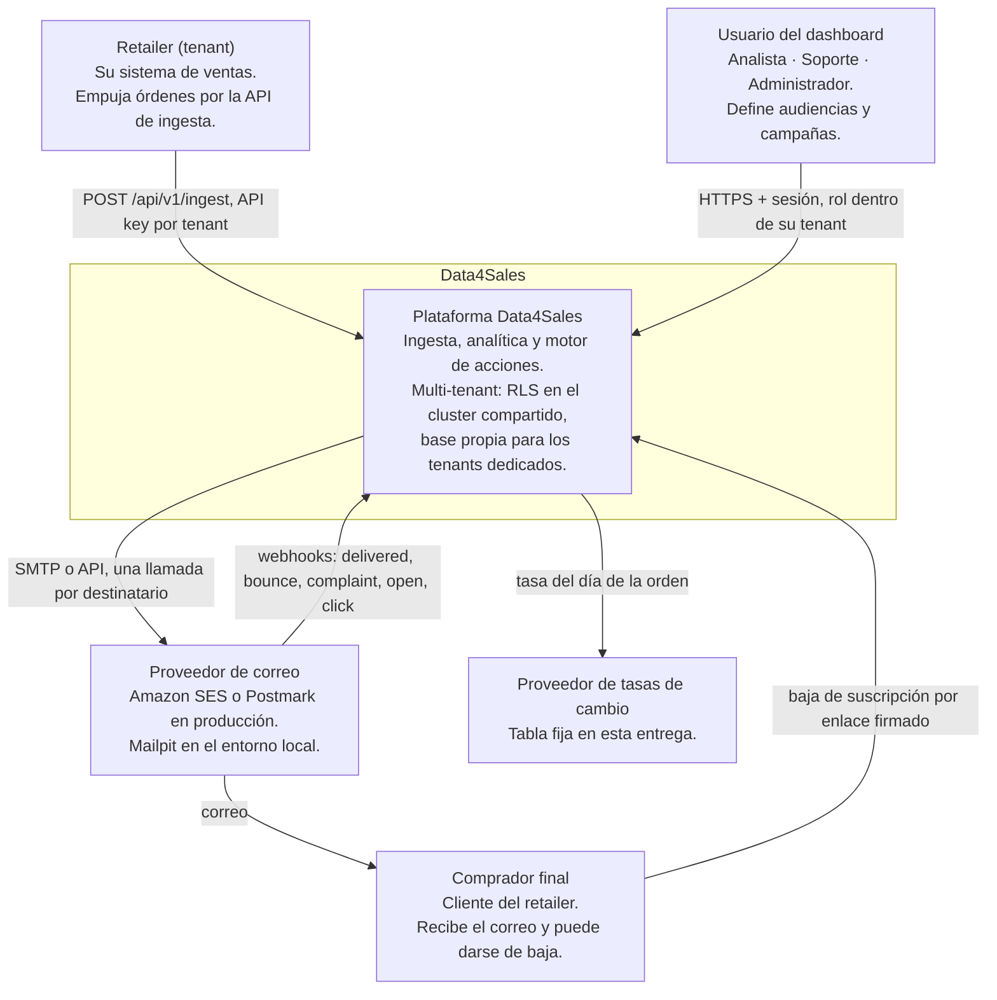
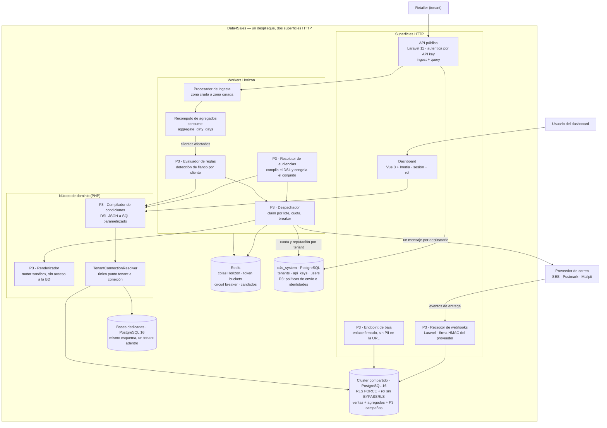
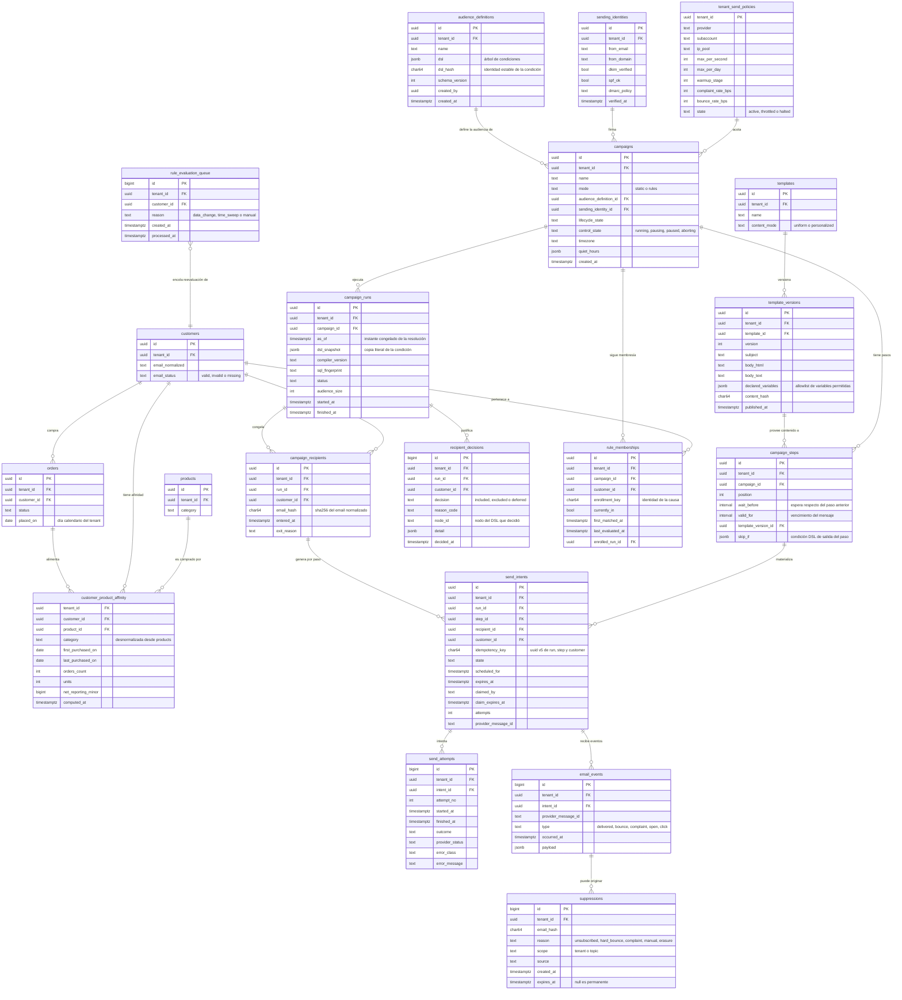
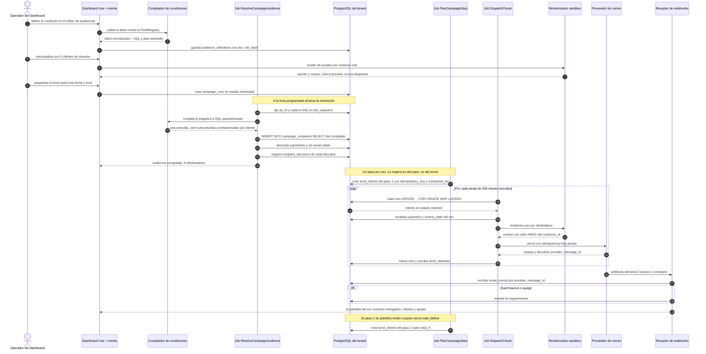
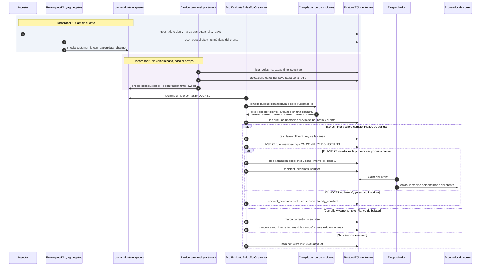
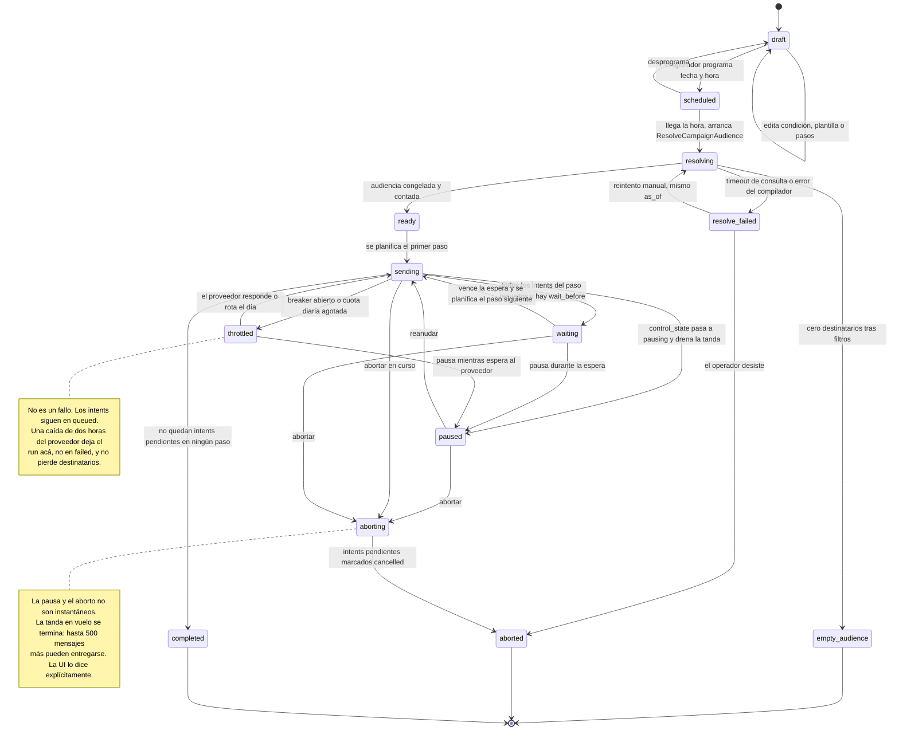
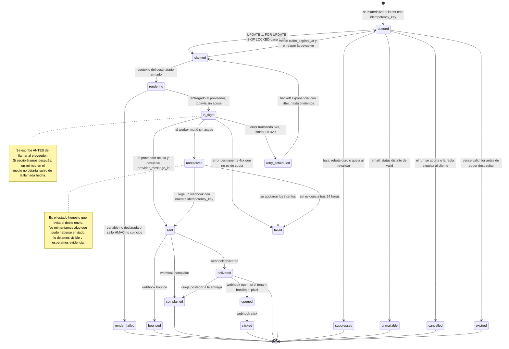
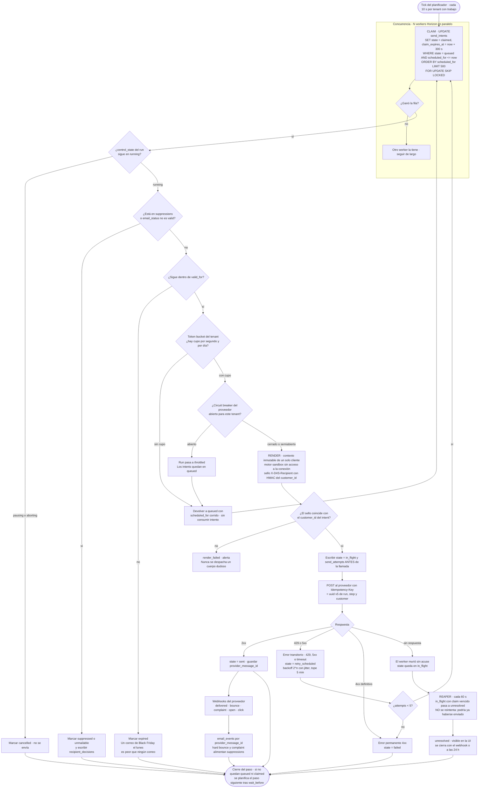

# Parte 3 — Motor de acciones sobre clientes

> **Documento de diseño _y_ recorte vertical implementado.** Lo que sigue es,
> en su mayor parte, diseño: el enunciado dice que un diseño excelente sin
> código vale más que una implementación apurada sobre un diseño confuso, y
> así se encaró. Pero el recorte que el enunciado ofrece como puntos extra
> **está construido y corriendo**: 31 archivos PHP en `app/Domain/Outreach/`,
> 11 tablas bajo Row-Level Security, y una campaña que resuelve su audiencia
> contra el dataset real y manda los correos. Qué entró, qué quedó afuera y
> por qué está en la [sección 9](#9-recorte-vertical--implementado).
>
> Donde el diseño y el código difieren, este documento lo aclara en el lugar
> donde ocurre. Documentar la intención como si fuera el estado sería la
> peor de las dos cosas.

Este documento diseña el mecanismo que permite **definir y ejecutar envíos de
correo a los compradores de un tenant**, sobre los datos que la Parte 1 ya
ingesta y cura.

Todo lo que sigue es coherente con las 35 decisiones de `DECISIONS.md` y se
apoya en el modelo de datos que ya existe. Cuando propongo una estructura
nueva, digo cómo se mantiene consistente con el origen y qué cuesta.

**Regla de escritura de este documento:** cada decisión va con su *por qué* y
su *costo*. Una decisión sin costo declarado es una decisión que todavía no
se entendió del todo. Cuando descarto una alternativa, digo cuál era.

---

## Índice

1. [Dónde encaja el motor](#1-dónde-encaja-el-motor)
2. [Representación de condiciones: el DSL](#2-representación-de-condiciones-el-dsl)
3. [Estructuras nuevas y cómo se mantienen consistentes](#3-estructuras-nuevas-y-cómo-se-mantienen-consistentes)
4. [Del DSL al SQL: el compilador](#4-del-dsl-al-sql-el-compilador)
5. [Los tres casos de prueba del enunciado](#5-los-tres-casos-de-prueba-del-enunciado)
6. [Modelo de datos del motor](#6-modelo-de-datos-del-motor)
7. [Los dos modos de ejecución](#7-los-dos-modos-de-ejecución)
8. [Aspectos transversales](#8-aspectos-transversales)
   - [8.1 Escala](#81-escala)
   - [8.2 Garantías de entrega](#82-garantías-de-entrega)
   - [8.3 Aislamiento multi-tenant](#83-aislamiento-multi-tenant)
   - [8.4 Privacidad y consentimiento](#84-privacidad-y-consentimiento)
   - [8.5 Observabilidad como requisito de producto](#85-observabilidad-como-requisito-de-producto)
   - [8.6 Fallas del proveedor de correo](#86-fallas-del-proveedor-de-correo)
   - [8.7 Control humano](#87-control-humano)
9. [Recorte vertical — implementado](#9-recorte-vertical--implementado)
10. [Lo que este diseño no resuelve](#10-lo-que-este-diseño-no-resuelve)
11. [Índice de diagramas](#11-índice-de-diagramas)

---

## 1. Dónde encaja el motor

El motor **no es un sistema aparte**. Es un dominio más (`App\Domain\Outreach`)
dentro del mismo monolito, con sus tablas dentro del plano de datos del tenant
y por lo tanto bajo las mismas políticas de Row-Level Security que las ventas.

Esa es la primera decisión y la más consecuente.

**Por qué.** La audiencia de una campaña *es* un subconjunto de `customers`.
Si el motor viviera en otro servicio con su propia base, la resolución de
audiencias sería una llamada de red que devuelve cientos de miles de UUIDs, y
el aislamiento entre tenants pasaría a depender de que ese servicio se acuerde
de filtrar — exactamente la garantía que D-02 se propuso sacar de las manos de
la aplicación. Dentro del mismo plano de datos, una condición mal compilada que
se olvide del `tenant_id` **igual devuelve cero filas de otro tenant**, porque
la política del motor la filtra.

**Costo.** El motor comparte el destino operativo del resto: mismo despliegue,
misma base, misma ventana de mantenimiento. Un backfill de audiencias compite
por I/O con la ingesta. Se mitiga con colas separadas en Horizon y con un
`statement_timeout` propio para las consultas de resolución (§4.5), pero no
desaparece. Si algún día el motor necesitara escalar independientemente, el
límite ya está dibujado: `Outreach` sólo lee del resto del dominio a través de
consultas compiladas, nunca de modelos Eloquent de `Sales`.

### 1.1 C4 nivel 1 — Contexto



Dos actores nuevos respecto de las Partes 1 y 2:

- **El comprador final.** Hasta ahora era un registro; acá pasa a ser alguien a
  quien la plataforma le habla. Eso trae obligaciones legales (baja, supresión,
  retención) que se tratan en §8.4.
- **El proveedor de correo.** Es la primera dependencia externa con la que la
  plataforma tiene una relación de reputación, no sólo de disponibilidad. Si un
  tenant manda a una lista comprada, el que queda en las listas negras es el
  dominio emisor, y eso afecta a los demás tenants (§8.3).

### 1.2 C4 nivel 2 — Contenedores



Tres enganches con lo existente que vale la pena señalar, porque son lo que
hace que esto no sea un sistema paralelo:

| Pieza existente | Qué le aporta al motor |
|---|---|
| `TenantConnectionResolver` | El motor nunca pregunta si un tenant es `shared` o `dedicated`. Un tenant dedicado corre sus campañas contra su propia base sin una línea de código distinta (D-01). |
| `aggregate_dirty_days` | Es el disparador del modo por reglas. El recómputo ya calcula qué clientes cambiaron; el motor se suscribe a esa lista en vez de sondear (§7.2). |
| `customer_metrics` | La mitad de las condiciones útiles se responden con una fila de esta tabla en vez de agregando órdenes al vuelo (§4.3). |

Y dos superficies HTTP nuevas, ambas **públicas y no autenticadas por sesión**,
que por eso mismo son las de mayor superficie de ataque del sistema:

- `POST /webhooks/mail/{provider}` — verificación de firma HMAC del proveedor
  antes de leer el cuerpo, y resolución del tenant **por el `provider_message_id`
  guardado en `send_intents`**, nunca por un campo del payload. Un webhook
  falsificado no puede elegir tenant.
- `GET /u/{token}` — baja de suscripción. El token es `HMAC(app_key,
  send_intent_id)` y el endpoint no revela nada: responde igual exista o no.

---

## 2. Representación de condiciones: el DSL

### 2.1 Qué se descartó primero

**SQL guardado en una columna.** Es lo más expresivo y lo más rápido de
construir. Se descarta por tres razones que no son de gusto: es ejecución de
código arbitrario contra la base de un tenant (una condición podría leer
`d4s_system` si la conexión lo permitiera, o hacer un `pg_sleep` de una hora);
no se puede renderizar en un editor visual, así que la condición la escribiría
soporte y no el usuario; y no se puede analizar, con lo cual es imposible saber
qué campañas hay que revisar cuando cambia el modelo.

**Un mini-lenguaje textual** tipo `orders(last 90d).count > 3 and never
bought(category:electro)`. Se lee mejor que JSON y es lo que hacen varias
herramientas del rubro. Se descarta porque hay que escribir y mantener un
parser con mensajes de error decentes, y porque el editor visual igual necesita
un árbol: el texto sería una capa de presentación sobre el mismo árbol, o sea
trabajo extra sin capacidad extra.

**Evaluar en PHP trayendo los clientes a memoria.** Correcto y trivial de
testear, imposible a la escala objetivo: 500.000 clientes × su historial de
órdenes no entran en memoria y no hay forma de paginar una condición que
depende de agregados.

### 2.2 La decisión: un árbol JSON versionado

La condición es un **árbol JSON**, guardado en `audience_definitions.dsl`
(`jsonb`), con un `schema_version` y un `dsl_hash` (SHA-256 del JSON
canonicalizado, claves ordenadas — la misma función `PayloadHasher` que ya usa
la ingesta).

**Por qué un hash.** Da identidad estable a una condición. Sirve para tres
cosas concretas: cachear el plan compilado, detectar que dos campañas usan la
misma condición, y — la importante — construir la `enrollment_key` del modo por
reglas, que es lo que impide que un cliente reciba dos veces el mismo envío por
la misma causa (§7.2).

**Costo.** Un árbol JSON es más verboso que SQL y menos expresivo a propósito:
no hay ventanas móviles arbitrarias, no hay auto-joins, no hay funciones. Todo
lo que el DSL no sabe expresar es una feature que hay que agregar al registro
de campos y al compilador, con su migración de `schema_version`. Es el precio
de poder garantizar que ninguna condición puede hacer daño.

### 2.3 Esquema del árbol

```jsonc
{
  "schema_version": 1,
  "root": { /* nodo */ }
}
```

**Nodos booleanos.** Componen, no evalúan nada por sí mismos.

```jsonc
{ "op": "and", "nodes": [ /* … */ ] }
{ "op": "or",  "nodes": [ /* … */ ] }
{ "op": "not", "node": { /* … */ } }
```

**Nodo de atributo.** Un predicado sobre una columna del cliente o de sus
métricas precalculadas. `field` no es un nombre de columna libre: es una clave
del `FieldRegistry` (§4.5), que la traduce a tabla, columna y tipo.

```jsonc
{
  "op": "attr",
  "id": "n_pais",
  "field": "customer.country",     // clave del registro, no SQL
  "cmp": "in",                     // eq ne gt gte lt lte in not_in between is_null matches
  "value": ["AR", "UY"]
}
```

**Los campos que existen en el código son siete**, todos con prefijo
`customer.` — el registro no distingue por prefijo de qué tabla sale el dato,
lo resuelve internamente (`FieldRegistry::FIELDS` en
`app/Domain/Outreach/Dsl/FieldRegistry.php`):

| Campo del DSL | Sale de | Tipo |
|---|---|---|
| `customer.email_status` | `customers.email_status` | string |
| `customer.country` | `customers.country` | string |
| `customer.segment` | `customer_metrics.segment` | string |
| `customer.orders_count` | `customer_metrics.net_orders_count` | int |
| `customer.total_net_minor` | `customer_metrics.total_net_reporting_minor` | int |
| `customer.avg_order_minor` | `customer_metrics.avg_order_reporting_minor` | int |
| `customer.recency_days` | `customer_metrics.recency_days` | int |

`FieldRegistry::usesDerivedMetrics()` es lo que separa las dos primeras de las
cinco restantes: una condición que sólo mira `customers` es exacta al
instante; una que toca `customer_metrics` es tan fresca como el último
recómputo, y por eso el comando de campaña reporta la frescura junto con el
conteo.

El diseño completo agrega más campos —fechas de primera y última compra,
scores RFM sueltos, conteo de devoluciones— y los ejemplos de este documento
(los de acá abajo y los de la §5) usan ese vocabulario más amplio
(`metrics.*`, junto con `or` y `purchased`), **no el del recorte**. Agregar un campo
es una línea en la constante; el motivo de que hoy sean siete es que son los
que el caso implementado necesita, y una lista blanca que promete campos que
no compilan es peor que una corta.

**Nodo agregado sobre órdenes.** Es el corazón del DSL: una ventana, un filtro
sobre las órdenes de esa ventana, y una lista de condiciones sobre agregados.

```jsonc
{
  "op": "orders",
  "id": "n_frecuencia",
  "window": { "kind": "relative", "last_days": 90 },
  "filter": {
    "status_in": ["paid", "shipped", "delivered"],
    "min_reporting_minor": 0,
    "category_in": null,
    "product_id_in": null
  },
  "having": [
    { "agg": "count",               "cmp": "gt",  "value": 3 },
    { "agg": "avg_reporting_minor", "cmp": "gte", "value": 8000 }
  ]
}
```

Agregados permitidos: `count`, `sum_reporting_minor`, `avg_reporting_minor`,
`min_reporting_minor`, `max_reporting_minor`, `sum_units`,
`distinct_categories`, `distinct_products`.

**Nodo de compra.** "Compró / nunca compró tal producto o tal categoría".
Existe como nodo propio y no como un `orders` con filtro porque se resuelve
contra una estructura distinta (§3.1) y porque la negación total sobre todo el
historial es un caso lo bastante frecuente como para merecer su propio plan.

```jsonc
{
  "op": "purchased",
  "id": "n_nunca_electro",
  "quantifier": "none",                       // any | none
  "match": { "category_in": ["electronica"] },// o product_id_in / sku_in
  "window": { "kind": "all_time" },
  "min_units": 1
}
```

**Nodo de última orden.** "Su última orden fue X y quedó en tal estado".
También es un nodo propio: `MAX(placed_at)` no es un filtro sobre órdenes, es
una selección de *una* orden, y confundirlos produce el bug clásico de "tuvo
*alguna* orden entregada hace 50 días" cuando lo que se pedía era que *la
última* lo fuera.

```jsonc
{
  "op": "last_order",
  "id": "n_ultima",
  "window": { "kind": "relative_range", "from_days_ago": 60, "to_days_ago": 45 },
  "status_in": ["delivered"]
}
```

**Ventanas.** Cuatro formas, relativas y absolutas:

| `kind` | Parámetros | Intervalo resuelto |
|---|---|---|
| `all_time` | — | sin cota |
| `relative` | `last_days: 90` | `(as_of_day − 90, as_of_day]` |
| `relative_range` | `from_days_ago: 60`, `to_days_ago: 45` | `[as_of_day − 60, as_of_day − 45)` |
| `absolute` | `from`, `to` (fechas) | `[from, to]`, inclusivo |

Tres reglas sobre ventanas, todas heredadas de D-07:

1. **`as_of` se congela una vez por ejecución.** Se guarda en
   `campaign_runs.as_of`. Sin eso, dos tandas de la misma resolución podrían
   caer a distintos lados de la medianoche y producir audiencias distintas para
   la misma campaña.
2. **El día es el día del tenant, no el UTC.** `as_of_day` se calcula como
   `(as_of AT TIME ZONE tenant.timezone)::date` y se compara contra
   `orders.placed_on`, que ya está precalculado. Nunca se aplica una función a
   `placed_at` en el `WHERE`: eso anularía el índice.
3. **El dinero en la condición es entero, en unidad mínima de la moneda de
   reporte del tenant.** El DSL rechaza un valor con coma. `"value": 8000` es
   80,00 en la moneda de reporte. Aceptar `80.0` sería reintroducir el error de
   punto flotante justo en el lugar donde decide a quién se le manda un correo.

### 2.4 Un ejemplo compuesto

Para que se vea el anidamiento real: *clientes de Argentina que, o bien
compraron más de 3 veces en los últimos 90 días, o bien están en el segmento
`champions`, y que en ningún caso hayan comprado electrónica*.

```json
{
  "schema_version": 1,
  "root": {
    "op": "and",
    "nodes": [
      { "op": "attr", "id": "pais", "field": "customer.country", "cmp": "eq", "value": "AR" },
      {
        "op": "or",
        "nodes": [
          {
            "op": "orders", "id": "frec90",
            "window": { "kind": "relative", "last_days": 90 },
            "filter": { "status_in": ["paid", "shipped", "delivered"] },
            "having": [ { "agg": "count", "cmp": "gt", "value": 3 } ]
          },
          { "op": "attr", "id": "seg", "field": "metrics.segment", "cmp": "eq", "value": "champions" }
        ]
      },
      {
        "op": "purchased", "id": "no_electro", "quantifier": "none",
        "match": { "category_in": ["electronica"] },
        "window": { "kind": "all_time" }
      }
    ]
  }
}
```

Notar el `id` de cada hoja. No es decorativo: es lo que permite que la respuesta
a *"¿por qué este cliente no recibió el correo?"* sea **"falló el nodo
`no_electro`, compró el producto `SKU-4471` el 2026-03-02 en la orden
`ORD-99812`"** y no un encogimiento de hombros (§8.5).

---
## 3. Estructuras nuevas y cómo se mantienen consistentes

El enunciado permite introducir estructuras adicionales si el diseño las
necesita, con la condición de explicar cómo se mantienen consistentes con el
origen. Introduzco **una tabla** y **dos columnas**. Nada más, y cada una tiene
una consulta que sin ella no cierra.

### 3.1 `customer_product_affinity` — qué compró cada cliente, alguna vez

```sql
CREATE TABLE customer_product_affinity (
    tenant_id               uuid    NOT NULL,
    customer_id             uuid    NOT NULL,
    product_id              uuid    NOT NULL,
    category                text,            -- desnormalizada desde products
    first_purchased_on      date    NOT NULL,
    last_purchased_on       date    NOT NULL,
    orders_count            integer NOT NULL DEFAULT 0,
    units                   integer NOT NULL DEFAULT 0,
    net_reporting_minor     bigint  NOT NULL DEFAULT 0,
    computed_at             timestamptz NOT NULL,
    PRIMARY KEY (tenant_id, customer_id, product_id)
);

CREATE INDEX cpa_by_product  ON customer_product_affinity (tenant_id, product_id, customer_id);
CREATE INDEX cpa_by_category ON customer_product_affinity (tenant_id, category, customer_id);
```

Más `RowLevelSecurity::protect('customer_product_affinity')`, como cualquier
tabla del plano de datos.

**Por qué existe.** Dos de las tres condiciones del enunciado son de la forma
*"compró / nunca compró X, en cualquier momento"*. Sin esta tabla, "nunca
compró de la categoría electrónica" se responde así:

```sql
NOT EXISTS (
  SELECT 1 FROM orders o
  JOIN order_items oi ON oi.order_id = o.id
  JOIN products p     ON p.id = oi.product_id
  WHERE o.customer_id = c.id AND p.category = 'electronica'
)
```

Sobre el tenant grande eso es un anti-join contra **todo** `order_items` — en
el orden de 10–15 millones de renglones — más el catálogo, y hay que hacerlo
sin ninguna cota temporal que lo achique. PostgreSQL lo resuelve con un hash
anti-join que construye una tabla hash de todos los compradores de la
categoría: funciona, pero es una lectura secuencial completa de la tabla más
grande del sistema por cada resolución de audiencia. Con la tabla de afinidad
es un recorrido de `cpa_by_category`, que devuelve directamente el conjunto de
`customer_id` a excluir.

Orden de magnitud: 500.000 clientes × ~6 productos distintos por cliente ≈ **3
millones de filas**, contra 10–15 millones de `order_items`. Con los tres
índices, unos **350–450 MB** para el tenant grande.

**Costos, los tres.**

1. **Almacenamiento y escritura.** Es un índice invertido más para mantener. Se
   suma al costo ya aceptado en D-04 de duplicar la zona cruda.
2. **Es un dato derivado más que puede divergir.** Se trata abajo.
3. **La categoría está desnormalizada.** Es la misma decisión (y el mismo
   riesgo) que ya tomó `daily_product_facts`: evita un join contra el catálogo
   en la consulta más frecuente, a cambio de que un cambio de categoría deje
   filas viejas hasta que se recomputen.

**Cómo se mantiene consistente.** Reusando el mecanismo que ya existe, sin
inventar uno nuevo:

- La ingesta ya marca el día de una orden en `aggregate_dirty_days` cada vez
  que la toca — alta, cambio de estado o dato tardío (D-06).
- `RecomputeDirtyAggregates` ya calcula, al final de su tanda, la lista exacta
  de clientes afectados (`customersAffectedBy()`), porque la necesita para
  recomputar `customer_metrics`.
- Se agrega una acción más, `RecomputeCustomerAffinity`, **dentro de la misma
  transacción** que `RecomputeCustomerMetrics`, sobre la misma lista de
  clientes. Su implementación es borrar y reinsertar las filas de esos
  clientes:

```sql
WITH afectados AS (
    SELECT unnest(:customer_ids::uuid[]) AS customer_id
),
borrado AS (
    DELETE FROM customer_product_affinity a
    USING afectados f
    WHERE a.tenant_id = :tenant_id AND a.customer_id = f.customer_id
)
INSERT INTO customer_product_affinity (
    tenant_id, customer_id, product_id, category,
    first_purchased_on, last_purchased_on,
    orders_count, units, net_reporting_minor, computed_at
)
SELECT
    o.tenant_id,
    o.customer_id,
    oi.product_id,
    p.category,
    MIN(o.placed_on),
    MAX(o.placed_on),
    COUNT(DISTINCT o.id),
    SUM(oi.quantity),
    -- Misma tasa congelada de la orden, nunca una nueva (D-14).
    SUM((oi.total_amount_minor * o.fx_rate)::bigint),
    NOW()
FROM orders o
JOIN afectados f    ON f.customer_id = o.customer_id
JOIN order_items oi ON oi.order_id   = o.id AND oi.tenant_id = o.tenant_id
JOIN products p     ON p.id          = oi.product_id AND p.tenant_id = o.tenant_id
WHERE o.tenant_id = :tenant_id
  AND o.status <> 'cancelled'
GROUP BY o.tenant_id, o.customer_id, oi.product_id, p.category;
```

**Por qué borrar y reinsertar en vez de un `UPSERT` incremental.** Un `UPSERT`
sabe sumar lo que llegó, pero no sabe *restar* lo que dejó de valer: si una
orden pasa a `cancelled`, hay que quitar sus unidades, y si era la única orden
con ese producto hay que borrar la fila entera. La lógica de resta es la que
inevitablemente se desincroniza. Recomputar desde cero el historial de un
cliente cuesta, para un cliente con 300 órdenes, leer 300 filas por un índice
que ya existe (`orders (tenant_id, customer_id, placed_at)`). Es barato y es
correcto por construcción.

**Costo declarado:** el recomputo es proporcional al historial completo del
cliente, no al delta. Un cliente con 5.000 órdenes se recomputa entero cada vez
que compra. Si eso apareciera como problema, la salida es acotar por
`last_purchased_on` y aceptar la lógica de resta — pero recién cuando el
problema exista y esté medido.

**Verificación, no confianza.** Un dato derivado que nadie revisa termina
mintiendo. Se agrega un comando `d4s:affinity:verify {tenant}` que compara, por
muestreo de 1.000 clientes, la tabla contra el recálculo desde `order_items`, y
reporta la deriva. Corre semanalmente y su resultado es una métrica. Sin esto,
la respuesta a *"¿estás seguro de que la afinidad está bien?"* sería una
opinión.

**Un hueco honesto.** Hoy la afinidad se ensucia cuando cambia una **orden**,
no cuando cambia un **producto**. Si un producto cambiara de categoría, las
filas de afinidad quedarían con la categoría vieja para siempre. Hoy no pasa,
porque D-13 dice que la ingesta no normaliza lotes de productos: la categoría
sólo entra por el camino de las órdenes. Cuando ese pipeline se implemente, hay
que encolar los compradores de ese producto para reevaluación — una consulta
sobre `cpa_by_product`, que es justo el índice que ya existe. Queda anotado
como precondición de esa tarea, no como descubrimiento futuro.

### 3.2 Dos columnas más en `customer_metrics`

```sql
ALTER TABLE customer_metrics
    ADD COLUMN last_order_id     uuid,
    ADD COLUMN last_order_status text;
```

**Por qué.** El caso 2 del enunciado ("su última orden fue hace entre 45 y 60
días y quedó entregada") necesita el *estado de la última orden*, y eso hoy
obliga a un `DISTINCT ON (customer_id)` sobre `orders`. Con estas dos columnas
la condición completa se responde con un recorrido del índice
`customer_metrics (tenant_id, last_order_at)`, sin tocar `orders`.

Se calculan en el mismo `INSERT ... ON CONFLICT` que ya existe en
`RecomputeCustomerMetrics::recomputeBaseMetrics()`, agregando dos columnas al
`SELECT` con una función de ventana:

```sql
(array_agg(o.id     ORDER BY o.placed_at DESC, o.id DESC))[1],
(array_agg(o.status ORDER BY o.placed_at DESC, o.id DESC))[1]
```

**Costo.** Es desnormalización pura: un dato que ya está en `orders` ahora está
en dos lados. Se paga con la misma moneda que el resto de las derivadas —
consistencia eventual acotada por la cola de días sucios — y se justifica con
la misma razón: sin ella, la consulta más común del motor toca la tabla más
grande.

**Costo real y medible:** el §5.2 muestra la consulta con y sin estas columnas
para que se vea cuánto compran.

### 3.3 Qué NO agregué, y por qué

**Ventanas móviles precalculadas** (`customer_window_metrics` con columnas de
30/90/365 días). Sería lo más rápido para el caso 1. Se descarta porque
congela las ventanas: el DSL permite cualquier `last_days`, y una tabla con tres
ventanas fijas obligaría a que el producto ofrezca sólo esas tres, o a mantener
dos caminos de resolución con semánticas distintas. Además hay que recalcularla
a diario **para todos los clientes aunque no hayan comprado**, porque una
ventana móvil cambia por el paso del tiempo, no por el dato: eso es un barrido
diario completo del tenant grande, que es exactamente el costo que D-06 evitó.
§5.1 muestra que el caso 1 se resuelve sin ella con un solo agregado agrupado.

**Una vista materializada de audiencias.** Refrescar es recalcular todo, y una
audiencia es por definición un dato de un instante. Ya está descartado por las
mismas razones que en D-06.

**Un motor de reglas en memoria tipo Rete.** Es lo correcto cuando hay miles de
reglas y hechos chicos. Acá hay decenas de reglas y hechos enormes que ya viven
indexados en PostgreSQL. Traerlos a memoria para evaluarlos sería mover el
problema al lado equivocado.

---

## 4. Del DSL al SQL: el compilador

`SqlCompiler` toma el árbol y devuelve **una** consulta parametrizada. No emite
nunca una subconsulta correlacionada por cliente, y no emite nunca N consultas.
Esa es la propiedad que hace que la cosa escale, y todo lo que sigue existe para
sostenerla.

### 4.1 Las cinco etapas

| Etapa | Clase | Qué hace |
|---|---|---|
| 1. Parseo | `ConditionParser` | Valida contra el JSON Schema y el `FieldRegistry`. Asigna `id` a las hojas que no lo traen. Aplica los límites de §4.5. Devuelve un árbol de objetos, no arrays. |
| 2. Normalización | `ConditionNormalizer` | Empuja los `not` hacia las hojas (De Morgan), colapsa `and`/`or` anidados del mismo tipo, y **deduplica hojas idénticas**: dos ramas que piden la misma ventana con el mismo filtro compilan a un solo CTE. |
| 3. Planificación | `ConditionPlanner` | Agrupa las hojas por fuente y decide, para cada una, si es **obligatoria** — si aparece sólo bajo `and` y sin ninguna negación arriba. |
| 4. Emisión | `SqlCompiler` | Produce `CompiledQuery{sql, bindings, nodeColumns}`. |
| 5. Explicación | `ExplainCompiler` | Mismo árbol, otra forma: una columna booleana por hoja, para un solo cliente (§8.5). |

La etapa 5 no es un extra. Es lo que evita que existan **dos**
implementaciones de la semántica de una condición — una que resuelve audiencias
y otra que explica por qué —, que es exactamente la clase de divergencia que
D-15 se ocupó de eliminar para los segmentos RFM. Acá vale lo mismo: la regla
vive una sola vez, en el árbol.

### 4.2 Obligatoria vs. opcional: por qué importa

Una hoja **obligatoria** puede compilarse como `INNER JOIN` con su condición
empujada al `HAVING` del CTE. Eso descarta filas lo más temprano posible: el
agregado ni siquiera materializa a los clientes que no llegan al umbral.

Una hoja que aparece bajo un `or` o bajo un `not` **no puede** hacerlo: si la
descarto en el `JOIN`, pierdo clientes que la rama alternativa sí incluiría. Se
compila como `LEFT JOIN` del CTE más una expresión booleana en el `WHERE`
(`COALESCE(w.orders_count, 0) > 3`), donde el `COALESCE` es lo que le da
sentido a "no tiene órdenes en la ventana" como *falso* y no como *nulo*.

**Costo declarado:** una condición con muchos `or` sobre agregados materializa
CTEs sobre toda la población en vez de sobre el subconjunto. Una condición con
cinco ventanas distintas unidas por `or` hace cinco pasadas agrupadas sobre
`orders`. El compilador lo sabe y lo dice: `CompiledQuery` expone un
`estimated_cost` y la UI muestra una advertencia antes de guardar. No lo
prohíbe — a veces esa condición es la que el negocio necesita —, pero no deja
que sea una sorpresa.

### 4.3 Reescrituras contra columnas precalculadas

El planificador tiene un catálogo chico de reescrituras: subárboles
reconocibles que se responden con una columna de `customer_metrics` en vez de
agregando `orders`.

| Subárbol | Reescritura |
|---|---|
| `orders` / `all_time` / `count` | `cm.orders_count` |
| `orders` / `all_time` / `count` con `status_not_in: [cancelled, returned]` | `cm.net_orders_count` |
| `orders` / `all_time` / `sum_reporting_minor` neto | `cm.total_net_reporting_minor` |
| `orders` / `all_time` / `avg_reporting_minor` neto | `cm.avg_order_reporting_minor` |
| `orders` / `all_time` / `count` con `status_in: [returned]` | `cm.returns_count` |
| `last_order` sin filtro de estado adicional | `cm.last_order_at`, `cm.last_order_status` |

**La reescritura es correcta sólo si las métricas están frescas.** Y no siempre
lo están: `customer_metrics` es eventualmente consistente por diseño (D-06). Por
eso el compilador consulta antes el **retraso de agregados**:

```sql
SELECT EXTRACT(EPOCH FROM NOW() - MIN(created_at))::int AS lag_seconds
FROM aggregate_dirty_days
WHERE tenant_id = :tenant_id AND processed_at IS NULL;
```

- Si `lag_seconds` es menor que `max_metrics_staleness` (por defecto **900 s**),
  reescribe.
- Si es mayor, **no reescribe**: compila contra las tablas base, más lento pero
  exacto.
- En los dos casos, el valor se guarda en `campaign_runs.metrics_lag_seconds`.

Ese último punto es el que convierte una decisión invisible en una respondible.
Seis meses después, cuando alguien pregunte por qué una campaña de marzo salió
con 4.000 destinatarios y la misma condición hoy da 4.100, la fila del run dice
con qué `as_of`, con qué versión del compilador y con cuánto retraso de
métricas se resolvió.

**Costo:** un `SELECT` extra por resolución (trivial), y dos caminos de
compilación que hay que testear los dos. El test es una property: para un
dataset dado, la forma reescrita y la forma base tienen que devolver el mismo
conjunto.

### 4.4 Dos formas de compilar la misma condición

Este es el punto donde el compilador ya distingue los dos modos de ejecución,
mucho antes de que haya un despachador de correos. No es un flag: son dos
planes distintos para la misma semántica.

| | `Shape::SetWide` (modo estático) | `Shape::PointBatch` (modo por reglas) |
|---|---|---|
| Pregunta | ¿Quiénes cumplen? | ¿Cuáles de *estos* cumplen? |
| Cardinalidad de entrada | Toda la población del tenant | 100–500 `customer_id` |
| Cláusula extra | — | `AND c.id = ANY(:customer_ids)` propagado a **cada CTE** |
| Plan típico | Seq scan por rango de fecha + hash aggregate | Index scan por `(tenant_id, customer_id, placed_at)` |
| Costo del caso 1 sobre el tenant grande | ~3 M filas agrupadas, segundos | ~2.000 filas, milisegundos |
| Cuándo corre | Una vez por `campaign_run` | Miles de veces por hora |

La propagación del `ANY(:customer_ids)` **dentro de cada CTE** es lo que hace la
diferencia. Si sólo se filtrara al final, cada CTE agregaría el tenant entero
para después descartar el 99,96% — el error de rendimiento más caro y más fácil
de cometer en este diseño.

### 4.5 El DSL como entrada no confiable

La condición la escribe un usuario del dashboard y se guarda en la base. Es
input no confiable con persistencia, que es la peor clase.

- **Nunca hay interpolación de strings en el SQL.** Los nombres de tabla y
  columna salen del `FieldRegistry` — una constante de clase en PHP, no una
  tabla de configuración ni nada que venga del request; todos los valores van
  como bindings posicionales. Un identificador no se puede parametrizar, así
  que la única defensa posible es que nunca provenga del usuario.
- **Whitelist, no blacklist.** Un `field`, un `agg` o un `cmp` que no esté en el
  registro es un error de validación, no un `default` que deja pasar.
- **Tipos.** El registro declara el tipo de cada campo y el parser castea y
  valida: `customer.orders_count` no acepta `"tres"`, y `customer.country` no
  acepta un array de 10.000 elementos (tope de 500 por `in`).
- **Límites estructurales.** Profundidad ≤ 8, hojas ≤ 32, ventanas ≤ 1.095 días,
  `and`/`or` con al menos 1 y a lo sumo 20 hijos. Sin esto, un árbol generado
  por un cliente de API puede producir una consulta que el planner tarda minutos
  en *planificar*, antes de ejecutarla.
- **`SET LOCAL statement_timeout = '120s'`** en la transacción de resolución.
  Una condición que no termina en dos minutos es un bug de diseño de la
  condición, y el run pasa a `resolve_failed` con esa causa explícita, en vez de
  ocupar una conexión hasta que alguien la mate.
- **RLS por debajo de todo.** La resolución corre dentro de
  `TenantContext::run()`. Si el compilador se olvidara del `tenant_id`, la
  política del motor igual filtra: el peor caso es una consulta lenta, nunca una
  fuga.
- **Aun así el compilador emite `tenant_id = :tenant_id` explícito.** No por
  seguridad — eso ya está — sino por el planificador: la cualificación de RLS
  usa `current_setting()`, que es `STABLE` y produce estimaciones de
  selectividad mucho peores que una constante. Con el `tenant_id` explícito el
  plan es predecible; sin él, PostgreSQL a veces elige un seq scan donde había
  un índice perfecto.

---
## 5. Los tres casos de prueba del enunciado

Para cada uno: el JSON del DSL, el SQL que produce el compilador en forma
`SetWide`, y qué índices usa. Los `:nombres` son bindings, nunca interpolación.

El tenant de referencia para los números es un tenant grande **hipotético**:
**500.000 clientes**, **4 millones de órdenes** en 120 días, **~12 millones de
renglones**. Es la escala contra la que se razonan los índices y los planes de
consulta, no el volumen que hay cargado en el entorno de evaluación (ver
«Perfil» en el README).

> **Vocabulario.** Los JSON de esta sección usan el diccionario de campos del
> **diseño completo** (`metrics.*`, `ever_status_in`, `purchased`), no el del
> recorte implementado, que tiene siete campos `customer.*` y rechaza por
> nombre lo que no compila (§2, §9.1). Se dejan así a propósito: la sección
> muestra qué expresa el DSL, no qué corre hoy.

---

### 5.1 Caso 1 — Más de 3 compras en 90 días, ticket promedio alto, nunca compró una categoría

> *Clientes que compraron más de tres veces en los últimos 90 días, con ticket
> promedio por encima de cierto monto, y que nunca compraron de una categoría
> determinada.*

**DSL**

```json
{
  "schema_version": 1,
  "root": {
    "op": "and",
    "nodes": [
      {
        "op": "orders",
        "id": "frec_90d",
        "window": { "kind": "relative", "last_days": 90 },
        "filter": { "status_in": ["paid", "shipped", "delivered"] },
        "having": [
          { "agg": "count",               "cmp": "gt",  "value": 3 },
          { "agg": "avg_reporting_minor", "cmp": "gte", "value": 8000 }
        ]
      },
      {
        "op": "purchased",
        "id": "nunca_electro",
        "quantifier": "none",
        "window": { "kind": "all_time" },
        "match": { "category_in": ["electronica"] }
      }
    ]
  }
}
```

**SQL generado**

```sql
WITH frec_90d AS (
    SELECT
        o.customer_id,
        COUNT(*)                      AS orders_count,
        SUM(o.reporting_amount_minor) AS revenue_minor
    FROM orders o
    WHERE o.tenant_id  = :tenant_id
      AND o.status     IN ('paid', 'shipped', 'delivered')
      AND o.placed_on  >  (:as_of_day::date - 90)
      AND o.placed_on  <= :as_of_day::date
    GROUP BY o.customer_id
    HAVING COUNT(*) > 3
       -- Ticket promedio SIN dividir. Multiplicar el umbral por la cuenta
       -- mantiene toda la comparación en enteros: dividir devolvería
       -- numeric o, peor, haría truncamiento entero y un cliente con
       -- promedio 79,99 pasaría como 79. Coherente con D-07.
       AND SUM(o.reporting_amount_minor) >= :avg_min::bigint * COUNT(*)
)
SELECT c.id AS customer_id
FROM customers c
JOIN frec_90d f ON f.customer_id = c.id
WHERE c.tenant_id    = :tenant_id
  AND c.email_status = 'valid'
  AND NOT EXISTS (
        SELECT 1
        FROM customer_product_affinity a
        WHERE a.tenant_id   = :tenant_id
          AND a.category    = :categoria
          AND a.customer_id = c.id
  )
ORDER BY c.id;
```

**Índices que usa y por qué no degrada**

| Paso | Índice | Comentario |
|---|---|---|
| Rango de 90 días | `orders (tenant_id, placed_on)` — ya existe | Recorrido de rango. `placed_on` está **precalculado** en la zona del tenant (D-07), así que no hay función sobre la columna y el índice se usa. |
| Agrupado por cliente | — | `HashAggregate` sobre ~3 M filas. Es el paso caro: **segundos**, no milisegundos. Va en un worker, no en un request. |
| Filtro `status` | — | No está en el índice: se aplica como filtro sobre las filas ya recorridas. Descarta ~8%. |
| Anti-join de categoría | `cpa_by_category (tenant_id, category, customer_id)` — **nuevo** | Recorrido de rango que devuelve los compradores de la categoría ya ordenados por `customer_id`. Merge anti-join contra el resultado del CTE, que también sale ordenado por cliente. |
| `email_status` | — | Filtro barato sobre un conjunto ya chico. Se aplica al final a propósito. |

**Índice opcional que convierte segundos en subsegundos:**

```sql
CREATE INDEX orders_audience_window_idx
    ON orders (tenant_id, placed_on)
    INCLUDE (customer_id, reporting_amount_minor, status);
```

Convierte el recorrido en **index-only scan**: no toca el heap. Costo: ~200 MB
extra en el tenant grande y una entrada de índice más que escribir en cada
`INSERT`/`UPDATE` de órdenes, es decir en el camino de la ingesta, que es el más
caliente del sistema. **Por eso lo dejo como opcional y no como parte del
diseño base:** conviene sólo si se mide que las resoluciones dominan y la
ingesta tiene margen. Ponerlo "por las dudas" es hacer más lenta la ingesta de
todos los tenants para acelerar una operación por lotes.

**Por qué no degrada al crecer.** Los dos términos son sublineales respecto del
historial total: el primero está acotado por la ventana (90 días, no 3 años), y
el segundo por el índice de afinidad (no por `order_items`). Duplicar la
historia del tenant no cambia el costo del caso 1; duplicar el *tráfico diario*
sí, linealmente y de forma predecible.

**Nota semántica.** `status_in: ["paid","shipped","delivered"]` es explícito a
propósito. "Compró tres veces" con órdenes canceladas adentro es una condición
que le manda un correo de fidelización a alguien que devolvió todo, y ese error
no se ve hasta que el cliente contesta el correo.

---

### 5.2 Caso 2 — Última orden hace entre 45 y 60 días, entregada, sin devoluciones

> *Clientes cuya última orden fue hace entre 45 y 60 días, quedó entregada, y
> que no tuvieron devoluciones.*

**DSL**

```json
{
  "schema_version": 1,
  "root": {
    "op": "and",
    "nodes": [
      {
        "op": "last_order",
        "id": "ultima_45_60",
        "window": { "kind": "relative_range", "from_days_ago": 60, "to_days_ago": 45 },
        "status_in": ["delivered"]
      },
      {
        "op": "orders",
        "id": "sin_devoluciones",
        "window": { "kind": "all_time" },
        "filter": { "status_in": ["returned"] },
        "having": [ { "agg": "count", "cmp": "eq", "value": 0 } ]
      }
    ]
  }
}
```

**SQL generado (con las columnas de §3.2 y métricas frescas)**

```sql
SELECT c.id AS customer_id
FROM customer_metrics cm
JOIN customers c
      ON c.id = cm.customer_id
     AND c.tenant_id = cm.tenant_id
WHERE cm.tenant_id        = :tenant_id
  AND cm.last_order_at   >= :as_of::timestamptz - INTERVAL '60 days'
  AND cm.last_order_at    < :as_of::timestamptz - INTERVAL '45 days'
  AND cm.last_order_status = 'delivered'
  AND cm.returns_count     = 0
  AND c.email_status       = 'valid'
ORDER BY c.id;
```

Una tabla, un índice, cero joins contra `orders`. En el tenant grande el rango
de 15 días de recencia toca del orden de **10.000–20.000 filas** de
`customer_metrics`: **milisegundos**.

**SQL generado si las métricas están atrasadas** (`lag_seconds > 900`, §4.3).
El compilador cae al camino exacto:

```sql
WITH candidatos AS (
    -- Prefiltro barato: aunque cm esté algo atrasada, sirve para acotar.
    -- Se ensancha el rango 2 días de cada lado para no perder a nadie por
    -- el desfasaje, y la verificación exacta la hace el CTE siguiente.
    SELECT cm.customer_id
    FROM customer_metrics cm
    WHERE cm.tenant_id      = :tenant_id
      AND cm.last_order_at >= :as_of::timestamptz - INTERVAL '62 days'
      AND cm.last_order_at  < :as_of::timestamptz - INTERVAL '43 days'
),
ultima AS (
    SELECT DISTINCT ON (o.customer_id)
           o.customer_id,
           o.id        AS order_id,
           o.status,
           o.placed_at
    FROM orders o
    JOIN candidatos k ON k.customer_id = o.customer_id
    WHERE o.tenant_id = :tenant_id
    ORDER BY o.customer_id, o.placed_at DESC, o.id DESC
)
SELECT c.id AS customer_id
FROM ultima u
JOIN customers c ON c.id = u.customer_id AND c.tenant_id = :tenant_id
WHERE u.status      = 'delivered'
  AND u.placed_at  >= :as_of::timestamptz - INTERVAL '60 days'
  AND u.placed_at   < :as_of::timestamptz - INTERVAL '45 days'
  AND c.email_status = 'valid'
  AND NOT EXISTS (
        SELECT 1
        FROM orders r
        WHERE r.tenant_id   = :tenant_id
          AND r.customer_id = u.customer_id
          AND r.status      = 'returned'
  )
ORDER BY c.id;
```

**Índices que usa y por qué no degrada**

| Paso | Índice | Comentario |
|---|---|---|
| Recencia | `customer_metrics (tenant_id, last_order_at)` — ya existe | Recorrido de rango. La selectividad es el punto: 15 días de 120 son ~12% de los clientes activos. |
| Última orden por candidato | `orders (tenant_id, customer_id, placed_at)` — ya existe | `DISTINCT ON` con ese orden se resuelve como recorrido de índice por candidato tomando la primera fila. ~15.000 recorridos de tres niveles. |
| Anti-join de devoluciones | `orders (tenant_id, customer_id, placed_at)` | Recorrido acotado al cliente. Podría necesitar un índice parcial `WHERE status = 'returned'` si el volumen de devoluciones creciera; hoy no lo agrego porque no está medido. |

**Por qué `last_order_at` y no `recency_days`.** `customer_metrics` tiene una
columna `recency_days` calculada en el recomputo. Usarla acá sería un bug de
verdad: **cuenta días desde el último recomputo, no desde hoy**. Un cliente
recomputado hace tres días tiene `recency_days` tres días corto, y la condición
"entre 45 y 60" lo dejaría afuera o adentro por azar. `last_order_at` es un
instante absoluto y no envejece. **Regla general del compilador: nunca reescribir
una ventana temporal contra una columna que expresa una duración relativa a un
recomputo.**

*Estado en el código, sin adornos:* `customer.recency_days` **está** en el
`FieldRegistry` del recorte y **no lleva ninguna marca** que impida usarla.
Un usuario que la ponga en una condición obtiene ese sesgo. Lo que sí existe
es `usesDerivedMetrics()`, que hace que la campaña reporte la frescura de las
métricas — se ve el problema, no se previene. La marca de "no reescribible"
es parte del diseño, no del código; hasta que exista, esta regla se sostiene
por criterio de quien escribe la condición, que es exactamente la clase de
garantía que el resto del sistema evita.

**Nota semántica sobre "sin devoluciones".** El DSL distingue dos cosas que se
parecen: `status_in: ["returned"]` mira el **estado actual** de la orden, y
`ever_status_in: ["returned"]` mira `order_status_history`. En nuestro modelo
`returned` es terminal (`OrderStatus::isTerminal()`), así que hoy dan lo mismo y
uso la primera, que es mucho más barata. Si algún retailer mandara transiciones
que salen de `returned` — y el sistema las acepta, porque D-13/`OrderStatus` no
rechaza transiciones raras a propósito —, la primera empezaría a mentir. Por eso
la segunda existe en el DSL y compila así:

```sql
AND NOT EXISTS (
      SELECT 1
      FROM order_status_history h
      JOIN orders o2 ON o2.id = h.order_id AND o2.tenant_id = h.tenant_id
      WHERE h.tenant_id    = :tenant_id
        AND o2.customer_id = u.customer_id
        AND h.to_status    = 'returned'
)
```

Con el índice `order_status_history (tenant_id, order_id, occurred_at)` que ya
existe, más el join contra `orders`. Es más cara y la UI lo dice al elegirla.

---

### 5.3 Caso 3 — Compró un producto pero no otro, en cualquier momento

> *Clientes que compraron un producto pero no otro, en cualquier momento.*

**DSL**

```json
{
  "schema_version": 1,
  "root": {
    "op": "and",
    "nodes": [
      {
        "op": "purchased",
        "id": "compro_a",
        "quantifier": "any",
        "window": { "kind": "all_time" },
        "match": { "product_id_in": ["7f0e…-A"] }
      },
      {
        "op": "purchased",
        "id": "no_compro_b",
        "quantifier": "none",
        "window": { "kind": "all_time" },
        "match": { "product_id_in": ["9c21…-B"] }
      }
    ]
  }
}
```

**SQL generado**

```sql
SELECT c.id AS customer_id
FROM customer_product_affinity si
JOIN customers c
      ON c.id = si.customer_id
     AND c.tenant_id = si.tenant_id
WHERE si.tenant_id  = :tenant_id
  AND si.product_id = :producto_a
  AND c.email_status = 'valid'
  AND NOT EXISTS (
        SELECT 1
        FROM customer_product_affinity ex
        WHERE ex.tenant_id   = :tenant_id
          AND ex.customer_id = si.customer_id
          AND ex.product_id  = :producto_b
  )
ORDER BY c.id;
```

**Índices que usa y por qué no degrada**

| Paso | Índice | Comentario |
|---|---|---|
| Compradores de A | `cpa_by_product (tenant_id, product_id, customer_id)` — nuevo | Recorrido de rango. Devuelve **sólo** los compradores de A: si A lo compraron 8.000 personas, el conjunto de trabajo es 8.000, no 500.000. |
| Anti-join de B | `PRIMARY KEY (tenant_id, customer_id, product_id)` — nuevo | Búsqueda puntual por clave primaria, una por candidato. |
| Join a `customers` | PK de `customers` | Puntual. |

**Éste es el caso que justifica la tabla de afinidad por sí solo.** Sin ella la
consulta equivalente es:

```sql
-- Lo que habría que escribir SIN customer_product_affinity
SELECT DISTINCT o.customer_id
FROM orders o
JOIN order_items oi ON oi.order_id = o.id
WHERE o.tenant_id = :tenant_id AND oi.product_id = :producto_a
  AND NOT EXISTS (
    SELECT 1 FROM orders o2
    JOIN order_items oi2 ON oi2.order_id = o2.id
    WHERE o2.tenant_id = :tenant_id
      AND o2.customer_id = o.customer_id
      AND oi2.product_id = :producto_b
  )
```

Dos recorridos de `order_items` (12 M de filas) más un `DISTINCT` sobre el
resultado. Con el índice `order_items (tenant_id, product_id)` que ya existe no
es catastrófico, pero cada fila de `order_items` obliga a ir a `orders` a buscar
el `customer_id`, porque el renglón no lo tiene: **eso es un acceso aleatorio al
heap por cada renglón**. La afinidad guarda `customer_id` y `product_id` en la
misma fila, que es precisamente el join que no queremos hacer al vuelo.

**La dirección del recorrido importa.** El compilador siempre elige como lado
conductor el `quantifier: "any"` (el conjunto chico) y deja el `"none"` como
anti-join. Si una condición tuviera sólo nodos `none` — *"nunca compró ni A ni
B"* —, no hay lado chico y hay que conducir desde `customers`; el planificador
lo detecta y emite `FROM customers c` con dos `NOT EXISTS`, y marca la condición
como **cara** en el `estimated_cost` porque recorre toda la población. La UI
sugiere agregar al menos un predicado positivo. Es una limitación real del
diseño, no un caso que se resuelva solo.

---
## 6. Modelo de datos del motor

Todo lo que sigue es nuevo respecto de la Parte 1. Las únicas tres entidades
existentes que aparecen (`customers`, `orders`, `products`) están dibujadas
sólo para mostrar dónde se engancha.

**Todas las tablas del plano de datos llevan `tenant_id` y
`RowLevelSecurity::protect()`.** Las dos excepciones (`tenant_send_policies` y
`sending_identities`) viven en `d4s_system` y se explican abajo.



### 6.1 Las decisiones que están dentro de ese diagrama

**`send_intents` es la unidad de trabajo, no `campaign_recipients`.** Un
destinatario en una campaña de 3 pasos genera 3 intents. Separarlos es lo que
permite que el paso 2 tenga su propio vencimiento, su propio estado y su propia
supresión: alguien puede darse de baja entre el paso 1 y el paso 2, y el paso 2
tiene que respetarlo sin que eso invalide el paso 1 ya enviado. *Costo:* una
fila por (destinatario × paso), es decir 1,5 M de filas para una campaña de 3
pasos sobre 500 K personas. Se trata en §8.1.

**`idempotency_key` es determinística, no aleatoria.**
`uuid_v5(namespace_campaña, run_id || step_id || customer_id)`. Que sea
determinística es lo que hace que un reintento después de un reinicio produzca
**la misma** clave y no una nueva. Si fuera un `uuid4()` generado al vuelo, un
reintento sería un mensaje nuevo para el proveedor y el destinatario recibiría
dos. Es la pieza central de §8.2.

**`suppressions` guarda `email_hash`, no el email.** SHA-256 del email
normalizado. Motivo: la lista de supresión tiene que sobrevivir al borrado del
cliente por derecho al olvido. Si guardara el email en claro, "borrame" y "no me
escribas más" serían pedidos contradictorios; con el hash se puede seguir
respetando la baja sin conservar el dato personal. *Costo:* no se puede
inspeccionar la lista de supresión a ojo, y para saber si un email está
suprimido hay que hashearlo primero. Ambas cosas son aceptables; la segunda es
justamente lo que hace el despachador.

**`recipient_decisions` no tiene una fila por cliente del tenant.** Sólo por los
que la condición incluyó y algo posterior descartó. La razón y las
consecuencias están en §8.5.

**`tenant_send_policies` y `sending_identities` viven en el plano de control.**
Son configuración y reputación, no datos del retailer. Y hay una razón
operativa: cuando el equipo de la plataforma necesita bajar la cuota de un
tenant que está quemando la reputación del pool compartido, tiene que poder
hacerlo **sin abrir la base del tenant**, y a las 3 de la mañana. *Costo:* el
plano de control no tiene RLS (D-03), así que el aislamiento de estas dos tablas
lo garantiza la aplicación. Se acepta con el mismo argumento de D-03: no
contienen PII de compradores.

**`campaign_runs` guarda `dsl_snapshot`, `compiler_version` y `sql_fingerprint`.**
Es lo que hace reproducible una resolución de hace seis meses. Sin el snapshot,
editar la condición reescribe la historia de todas las campañas que la usaron:
la pregunta *"¿por qué esta persona entró en la campaña de marzo?"* se volvería
irrespondible en cuanto alguien tocara el árbol. Es el mismo principio que hace
que D-14 congele la tasa de cambio en la fila de la orden.

---

## 7. Los dos modos de ejecución

El enunciado dice explícitamente que no son la misma cosa con un flag distinto.
Coincido, y la razón de fondo es esta:

> En el modo estático, la audiencia es un **valor**: un conjunto que se calcula
> una vez y después no cambia.
> En el modo por reglas, la audiencia es un **flujo de eventos**: un predicado
> cuya verdad cambia con el tiempo, del que interesan los **flancos de subida**.

Un conjunto se materializa. Un flanco se detecta, y detectarlo exige recordar
el valor anterior — un estado que el modo estático directamente no tiene.
Segundo: "no reenviar por la misma causa" requiere que exista una **causa
identificable**; el modo estático la obtiene gratis (`run_id`), el modo por
reglas tiene que construirla (`enrollment_key`). Ningún flag agrega estado ni
inventa identidad.

### 7.1 Modo conjunto estático

**Qué es.** La condición se resuelve en un momento dado, el conjunto queda
congelado, y se envía el mismo contenido en un momento planificado, con una
secuencia opcional de pasos y esperas.

**Ciclo completo**



**Tres decisiones dentro de esa secuencia.**

*La audiencia se materializa con `INSERT ... SELECT`, no trayendo UUIDs a PHP.*
500.000 UUIDs son 8 MB de memoria y un round-trip inútil: el resultado del
compilado nunca sale de la base.

```sql
INSERT INTO campaign_recipients (id, tenant_id, run_id, customer_id, email_hash, entered_at)
SELECT gen_random_uuid(), :tenant_id, :run_id, q.customer_id,
       encode(digest(cu.email_normalized, 'sha256'), 'hex'), :as_of
FROM ( /* ← acá va el SQL compilado del §5 */ ) q
JOIN customers cu ON cu.id = q.customer_id AND cu.tenant_id = :tenant_id
WHERE NOT EXISTS (
    SELECT 1 FROM suppressions s
    WHERE s.tenant_id = :tenant_id
      AND s.email_hash = encode(digest(cu.email_normalized, 'sha256'), 'hex')
      AND (s.expires_at IS NULL OR s.expires_at > :as_of)
);
```

*Los pasos se materializan de a uno.* Crear los intents de los tres pasos al
resolver sería más simple, pero un paso 3 programado para dentro de 10 días
tendría que decidir hoy su contenido y su vencimiento, y no podría respetar un
`skip_if` ("no le mandes el recordatorio si ya compró"). Materializar tarde
cuesta un job más y un estado `waiting` en la máquina del run; compra que la
secuencia reaccione a lo que pasó en el medio.

*El congelamiento es una promesa que hay que sostener.* Alguien que se dio de
baja después del congelamiento **no** puede recibir el correo. Por eso la
supresión se revalida en el momento del claim, no sólo al resolver (§8.4). El
conjunto congelado es de *candidatos*, no de *envíos garantizados*, y la UI lo
dice: "audiencia: 48.213 · enviados: 47.902 · excluidos después del
congelamiento: 311".

### 7.2 Modo por reglas, evaluado de forma continua

**Qué es.** La condición se evalúa permanentemente, cada cliente entra
individualmente cuando la cumple, recibe contenido personalizado, y no puede
recibir el mismo envío dos veces por la misma causa.



**Los dos disparadores, y por qué hacen falta los dos.**

Éste es el punto que más fácil se pasa por alto y el que más rompe en
producción.

*Disparador 1 — cambió el dato.* Es el barato y el que ya está construido: la
ingesta marca `aggregate_dirty_days`, `RecomputeDirtyAggregates` calcula qué
clientes tocó, y esos `customer_id` se encolan en `rule_evaluation_queue`. Es
literalmente **una línea más** al final de `RecomputeDirtyAggregates::handle()`.
No hay sondeo, no hay tabla de watermarks, no hay triggers: se reusa un
mecanismo que ya existe, ya está testeado y ya resuelve el mismo problema para
los agregados.

*Disparador 2 — no cambió nada, pasó el tiempo.* La condición del caso 2 ("su
última orden fue hace entre 45 y 60 días") **se vuelve verdadera sin que ocurra
ningún evento**. El cliente compró hace 44 días y mañana entra en la ventana sin
haber hecho nada. Si el motor sólo reaccionara a cambios de datos, esa campaña
— que es exactamente la clase de campaña que más se usa: reactivación,
carrito abandonado, aniversario — nunca dispararía. Peor: fallaría en silencio,
sin ningún error, y el síntoma sería "la campaña no manda nada" tres semanas
después.

Solución: el parser marca cada condición como `time_sensitive` si contiene
alguna ventana `relative` o `relative_range`, y un barrido diario por tenant, a
una hora tranquila de su zona horaria, encola a los clientes que *podrían*
haber cruzado el borde. El barrido no reevalúa a todos: usa la ventana de la
regla para acotar. Para el caso 2:

```sql
-- Barrido diario del caso 2: sólo quienes pueden haber entrado hoy.
SELECT cm.customer_id
FROM customer_metrics cm
WHERE cm.tenant_id      = :tenant_id
  AND cm.last_order_at >= NOW() - INTERVAL '61 days'
  AND cm.last_order_at  < NOW() - INTERVAL '44 days'
```

Del orden de 15.000 clientes por día en el tenant grande, no 500.000.

*Costo declarado:* la latencia de entrada al flujo es de hasta 24 h para las
condiciones que dependen sólo del paso del tiempo. Para "carrito abandonado
hace 2 horas" eso no sirve, y la salida sería un barrido horario para reglas de
ventana corta. No lo agrego hoy porque el enunciado no lo pide y porque duplica
la carga de barrido; queda declarado como la primera extensión natural.

**Cómo se evita el reenvío: la `enrollment_key`.**

```
enrollment_key = sha256( campaign_id || dsl_hash || customer_id || causa )
```

Y la barrera es un **índice único**, no una consulta previa:

```sql
CREATE UNIQUE INDEX rule_memberships_enrollment_unique
    ON rule_memberships (tenant_id, campaign_id, enrollment_key);
```

La inscripción es `INSERT ... ON CONFLICT DO NOTHING RETURNING id`. Si devuelve
fila, es la primera vez y se materializan los intents. Si no devuelve nada, ya
estaba: se registra `excluded / already_enrolled` y se sigue. **No hay ventana
de carrera entre consultar y escribir**, ni siquiera con dos workers evaluando
al mismo cliente en paralelo por dos disparadores distintos. Es exactamente el
mismo razonamiento del índice único sobre `(tenant_id, content_hash)` de la
ingesta (D-04): la unicidad la garantiza el motor, atómicamente.

**Lo difícil es definir "la misma causa".** Hay tres políticas y la elige el
operador por campaña, porque la respuesta correcta depende del negocio:

| Política | `causa` | Semántica | Ejemplo |
|---|---|---|---|
| `once_ever` | constante `'*'` | Una vez en la vida, aunque vuelva a cumplir | Correo de bienvenida |
| `once_per_reentry` | `first_matched_at` del flanco | Una vez por cada vez que entra desde afuera | Reactivación |
| `once_per_period` | `date_trunc('month', as_of)` | Una vez por período calendario | Resumen mensual |

El default es `once_per_reentry`, que es lo que la mayoría de la gente quiere
decir cuando dice "que no le llegue dos veces". Que la política esté **en la
clave** y no en un `if` del código es lo que hace que el índice único la
garantice: cambiar de política cambia la clave, no la lógica de verificación.

*Costo:* `once_per_reentry` sin histéresis produce oscilación. Un cliente cuya
última orden está justo en el borde de los 60 días puede entrar, salir y volver
a entrar si una orden tardía le corre la recencia (D-05: los datos tardíos son
normales, no excepcionales). Mitigación: `min_reentry_interval` por campaña, con
default de 30 días, que forma parte de la `causa`. No es gratis y no es perfecto:
es un tope explícito al daño.

**El contenido personalizado es la otra divergencia real.** En estático el
cuerpo se puede renderizar una vez y reusarse para 500.000 personas. En reglas
hay que renderizar uno por cliente, con sus datos. Eso cambia el pipeline de
envío: §8.4 explica por qué las llamadas en lote al proveedor están
**prohibidas** cuando el contenido es personalizado, y no es una optimización
perdida sino una barrera de seguridad.

### 7.3 Dónde comparten y dónde divergen

**Comparten** — y esto es lo que justifica que sean un solo sistema:

| Pieza | Notas |
|---|---|
| DSL, parser, normalizador y `FieldRegistry` | Idénticos. La misma condición sirve para las dos cosas. |
| `SqlCompiler` | Misma semántica, dos `Shape` (§4.4). |
| `templates` / `template_versions` | Mismo versionado y mismo `content_hash`. |
| `Renderer` sandbox | Idéntico, incluida la verificación del sello HMAC. |
| `send_intents`, `send_attempts`, `email_events` | El pipeline de despacho no sabe de qué modo viene un intent. |
| Supresión, cuotas, breaker, `sending_identities` | Transversales por definición. |
| `recipient_decisions` y la explicación por cliente | Mismo formato, misma pantalla. |
| Pausar y abortar | Mismo `control_state`. |

**Divergen necesariamente:**

| Aspecto | Estático | Por reglas | Por qué no se unifica |
|---|---|---|---|
| Naturaleza de la audiencia | Conjunto materializado en `campaign_recipients` | Predicado con estado en `rule_memberships` | Un conjunto no tiene "estado anterior"; un flanco no existe sin él. |
| Forma compilada | `SetWide` | `PointBatch` | Planes de ejecución opuestos: uno agrupa millones, el otro busca cientos por índice. |
| Disparo | Una vez, a una hora | Continuo: cambio de dato + barrido temporal | El estático no necesita saber que el tiempo pasa. |
| Identidad de la causa | `run_id` | `enrollment_key` computada | El run *es* la causa; en reglas hay que construirla y elegir política. |
| Contenido | Uniforme, se puede rendir una vez | Personalizado, uno por persona | Cambia si se puede o no batchear contra el proveedor. |
| Salida del flujo | No existe: quien entró, entró | `exit_on_unmatch` cancela pasos futuros | Sólo tiene sentido si la membresía puede volverse falsa. |
| Estimación previa | El operador ve "48.213 destinatarios" antes de mandar | Sólo se puede estimar un caudal por día | No hay un número total: la audiencia es infinita en el tiempo. |
| Perfil de carga | Ráfagas enormes y esporádicas | Goteo permanente | Exige colas separadas en Horizon (§8.1). |
| Modelo de costo | Una consulta cara por run | Miles de consultas baratas por hora | Optimizarlos juntos lleva a un plan malo para los dos. |

**La prueba de que no es un flag.** Si mañana hubiera que borrar el modo
estático, `rule_memberships`, el barrido temporal, la `enrollment_key` y el
`Shape::PointBatch` desaparecerían del código: no son configuración del modo
estático, son piezas que sólo existen para el otro. Y al revés: sin el modo
estático se caen `campaign_recipients` como conjunto congelado, `as_of`,
`dsl_snapshot` y el planificador de pasos con esperas. Lo que quedaría en pie
en los dos casos — DSL, compilador, render, despacho, supresión,
observabilidad — es exactamente lo que la tabla de arriba lista como
compartido. Eso es un límite real, no un flag.

### 7.4 Máquinas de estado

**La de un envío (`campaign_runs`)**



Dos cosas que se ven en el dibujo y son decisiones:

- **`empty_audience` es un estado, no un éxito.** Una campaña que resolvió cero
  destinatarios casi siempre es una condición mal escrita. Terminarla como
  `completed` la haría invisible; terminarla como `failed` haría que el operador
  la reintente sin cambiar nada. Un estado propio la pone en la lista de "revisá
  esto".
- **`throttled` no es `failed`.** Es la diferencia entre "el proveedor está
  caído dos horas" y "esta campaña se perdió" (§8.6).
- **El control (pausa/aborto) es una columna aparte, no un estado del ciclo de
  vida.** Se puede pausar durante la resolución, durante el envío y durante una
  espera, y al reanudar hay que volver *al estado en que se estaba*. Meterlo en
  la misma máquina obligaría a duplicar cada estado en su versión "pausada".
  *Costo:* dos columnas en vez de una, y la disciplina de que todo job lea las
  dos.

**La de un destinatario dentro del envío (`send_intents`)**



Los estados terminales son ocho y **cada uno es una respuesta distinta a "¿por
qué no le llegó?"**: `suppressed`, `unmailable`, `cancelled`, `expired`,
`render_failed`, `failed`, `bounced`, `complained`. Colapsarlos en un `failed`
genérico ahorraría columnas y haría irrespondible la pregunta del §8.5. Es el
mismo criterio que llevó a que `ingestion_rejects.reason` sea tipado y no texto
libre (D-04).

### 7.5 Pipeline de ejecución



**El claim, textual.** Es la pieza que hace todo lo demás posible, y es el mismo
patrón que `RecomputeDirtyAggregates::claimDirtyDays()` ya usa para los días
sucios:

```sql
UPDATE send_intents
SET    state             = 'claimed',
       claimed_by        = :worker_id,
       claim_expires_at  = NOW() + INTERVAL '300 seconds',
       attempts          = attempts + 1
WHERE  id IN (
    SELECT si.id
    FROM   send_intents si
    JOIN   campaign_runs r ON r.id = si.run_id
    WHERE  si.tenant_id     = :tenant_id
      AND  si.state         = 'queued'
      AND  si.scheduled_for <= NOW()
      -- Diseño: la pausa entra en el mismo UPDATE que reclama, para que no
      -- exista ninguna ventana entre leer el control y llevarse las filas.
      -- OJO: el recorte implementado NO tiene este JOIN ni esta cláusula.
      -- Ver "Diseño vs. código", más abajo.
      AND  r.control_state  = 'running'
    ORDER BY si.scheduled_for, si.id
    LIMIT :chunk
    FOR UPDATE SKIP LOCKED
)
RETURNING id, customer_id, step_id, idempotency_key;
```

`SKIP LOCKED` es lo que permite que N workers avancen sobre la misma cola sin
bloquearse: cada uno se lleva lo que nadie tomó. Sin él, veinte workers sobre
una campaña serían veinte procesos esperando el mismo lock, o sea un worker con
diecinueve espectadores.

**El `ORDER BY` importa más de lo que parece.** Sin orden total (`scheduled_for,
id`), dos workers pueden elegir subconjuntos solapados y el `SKIP LOCKED`
degenera en escaneos largos. Es el mismo razonamiento que D-17 aplicó a la
paginación por cursor: sin un orden total, el comportamiento es correcto pero
impredecible. El recorte ordena por `id` a secas, que también es total; el
`scheduled_for` de arriba sólo hace falta cuando existan pasos diferidos.

**Diseño vs. código: dónde se lee la pausa.** El SQL de arriba es el diseño.
`DispatchIntents::claim()` reclama sobre `send_intents` sin unirse a
`campaign_runs`: **el `UPDATE` no mira `control_state`**. La orden de pausa se
consulta en PHP, en `DispatchIntents::execute()`, con
`$campaign->isDispatchAllowed()`, **antes** de reclamar la tanda, y se vuelve a
consultar en cada tanda — no una sola vez al arrancar el run. Y en el recorte
la columna vive en `campaigns`, no en `campaign_runs` como propone §6: se pausa
la campaña, no el run. Con un run a la vez da lo mismo; con varios runs de la
misma campaña, no.

*La ventana que eso deja, dicha con todas las letras:* entre que
`isDispatchAllowed()` devuelve `true` y que el `UPDATE` se lleva las filas, un
operador puede pausar. Esa tanda ya reclamada **se termina de enviar**. Con
tandas de 100 (el default de `execute()`), el peor caso son 100 correos que
salen después de apretar "pausar". La pausa frena la tanda siguiente, no la
que ya está en vuelo. Mover la condición adentro del `UPDATE` cierra esa
ventana y es un cambio chico; no está hecho, y decir lo contrario sería
describir la intención en vez del estado.

---
## 8. Aspectos transversales

### 8.1 Escala

**El escenario:** una campaña estática de **500.000 destinatarios** en el tenant
grande, con 3 pasos.

**Dónde se rompería si no se cuidara, en orden de aparición.**

*1. Traer la audiencia a PHP.* 500.000 UUIDs son ~8 MB de strings más el
overhead de PHP, y no hay ninguna razón para que salgan de la base. La
materialización es un `INSERT ... SELECT` server-side (§7.1). **Ninguna consulta
del motor hace `->get()` sobre un conjunto no acotado.** El límite es
estructural: `ResolveAudience` no tiene forma de devolver una lista, sólo un
conteo.

*2. La transacción de materialización.* 500.000 filas de `campaign_recipients`
son ~50 MB de tabla más índices, y ~150 MB de WAL de una sola vez. Es aceptable
en un solo `INSERT` (10–30 s). A partir de ~2 M destinatarios hay que dividirlo
por rangos de hash (`abs(hashtext(customer_id::text)) % 16 = :bucket`), que es
determinístico y reanudable. **No lo implemento hoy**: agrega complejidad y el
umbral está lejos. Queda como la primera cosa a hacer cuando el tenant grande
crezca 10×, que es la pregunta 4 de la defensa.

*3. Una consulta por mensaje.* 500.000 `UPDATE` de una fila serían 500.000
round-trips. El despachador acumula el resultado de la tanda y escribe **una
sentencia por tanda**:

```sql
UPDATE send_intents si
SET    state = v.state,
       provider_message_id = v.msg_id,
       claimed_by = NULL,
       claim_expires_at = NULL
FROM  (VALUES (:id1, :st1, :msg1), (:id2, :st2, :msg2) /* … 500 */)
      AS v(id, state, msg_id)
WHERE si.id = v.id::uuid AND si.tenant_id = :tenant_id;
```

Con tandas de 500: **1.000 sentencias** para toda la campaña, no 500.000. Lo
mismo con `send_attempts`, que se escribe con un `INSERT` multi-fila.

*4. La cuota del proveedor.* Amazon SES arranca en **14 mensajes/segundo** hasta
que se pide una ampliación; Postmark y SendGrid tienen límites por plan. La
cuota es por tenant y vive en `tenant_send_policies`, implementada como **token
bucket en Redis** (`d4s:mail:{tenant}:bucket`), más un **bucket global**
(`d4s:mail:global`) que representa el límite de la cuenta del proveedor. Los dos
tienen que otorgar. Sin el global, diez tenants con 100/s cada uno le pegan al
proveedor con 1.000/s y lo que devuelve son `429` para todos.

*5. Dimensionar la concurrencia.* La fórmula es directa:

```
workers = ceil( rate_objetivo × latencia_p95_del_proveedor )
```

Con 100 msg/s y 120 ms de latencia: **12 workers**. Poner 100 workers no acelera
nada — el bucket los frena igual — y sí multiplica por 8 las conexiones a
PostgreSQL. Es un error caro y frecuente: la concurrencia la fija el
throughput deseado, no la cantidad de trabajo pendiente.

*6. Tiempos resultantes.*

| Cuota | 500.000 destinatarios |
|---|---|
| 14 msg/s (SES sin ampliar) | 9 h 55 min |
| 100 msg/s | 1 h 23 min |
| 500 msg/s | 16 min 40 s |

Esto no es un problema a resolver: **es el dato que el operador tiene que ver
antes de programar el envío**. La UI muestra la estimación al programar. Una
campaña que tarda 10 horas y arranca a las 18:00 llega de madrugada, y eso es
una decisión de negocio, no un detalle técnico.

*7. Las tablas que crecen sin techo.* `send_attempts` y `email_events` son las
grandes: una campaña de 500 K con 3 pasos y ~2,5 eventos por mensaje son **~3,7
millones de filas**. Se particionan por `RANGE (created_at)` mensual. La razón
no es la lectura, es el borrado: retirar un mes con `DROP TABLE` de la partición
es instantáneo, mientras que `DELETE FROM email_events WHERE created_at < …`
sobre 50 M de filas genera bloat, dispara un autovacuum agresivo y compite con
el envío en curso.

*8. Reparto justo entre tenants.* Dos colas separadas en Horizon:

- `mail-bulk` — campañas estáticas. Ráfagas enormes, tolerantes a latencia.
- `mail-flow` — modo por reglas. Goteo permanente, sensible a latencia: un
  "gracias por tu compra" que llega tres horas tarde perdió el sentido.

Y sobre `mail-bulk`, un despachador que **rota entre tenants con trabajo
pendiente** en vez de drenar una campaña hasta el final. Sin eso, la campaña de
500 K del tenant grande deja a un tenant chico esperando dos horas para mandar
800 correos. *Costo declarado:* Horizon no hace reparto justo por sí solo; es
un planificador que hay que escribir y testear (~150 líneas y un test de
inanición).

*9. Lo que NO hago.* No mando la resolución de audiencias a una réplica de
lectura. Sería lo correcto para no competir con la ingesta, pero el
`INSERT ... SELECT` tiene que correr en la primaria; partirlo en un `SELECT` en
la réplica y un `INSERT` en la primaria implica mover 500.000 UUIDs por la red,
que es justo lo que el punto 1 evita. La salida real, si la contención
apareciera, es una réplica *para la resolución completa* con `as_of` ajustado
por el lag de replicación. Está fuera de alcance y declarado.

### 8.2 Garantías de entrega

**La afirmación honesta primero: `exactly-once` de punta a punta es
imposible.** Entre nosotros y el proveedor hay una red, y una respuesta perdida
es indistinguible de una petición perdida — el problema de los dos generales. Si
mandamos y no nos contestan, no sabemos si el mensaje salió. Cualquier producto
que prometa "cada persona recibe exactamente una vez" está mintiendo o está
definiendo "recibir" de otra manera.

**Lo que sí es alcanzable:** transporte *at-least-once* + efecto idempotente =
**"efectivamente una vez"**, con un residuo pequeño, acotado y **visible** de
casos ambiguos. El diseño consiste en poner las barreras en los lugares
correctos y en no mentir sobre el residuo.

**Cuatro barreras, cada una contra un fallo distinto.**

| # | Barrera | Contra qué protege | Quién la garantiza |
|---|---|---|---|
| 1 | `UNIQUE (tenant_id, run_id, step_id, customer_id)` en `send_intents` | El planificador corrió dos veces | PostgreSQL, atómicamente |
| 2 | `UPDATE … state='queued' → 'claimed' … FOR UPDATE SKIP LOCKED` | Dos workers tomaron la misma fila | PostgreSQL, atómicamente |
| 3 | `Idempotency-Key` determinística en la llamada al proveedor | Llamamos dos veces por la misma fila | El proveedor, **si la honra** |
| 4 | `state = 'in_flight'` escrito **antes** de la llamada | El proceso murió durante la llamada | Nosotros. No deduplica: **deja evidencia** |

La barrera **autoritativa es la 2**. Las barreras 1 y 3 son defensas
adicionales; la 4 no deduplica nada, y ése es el punto: convierte "no sé qué
pasó" en "sé que pudo haber pasado", que es lo que permite decidir bien.

Sobre la 3, con honestidad: **no todos los proveedores honran una clave de
idempotencia** en el endpoint de envío simple. Donde no la honran, la barrera 3
no existe y todo el peso queda en la 2 y la 4. Por eso el diseño no depende de
ella.

**El caso exacto que pregunta el enunciado: el worker se reinicia a mitad de un
lote.** Un worker reclamó 500 intents, envió 213, y el proceso murió. Estado a
los 300 segundos (`DispatchIntents::CLAIM_TTL_SECONDS`, el vencimiento del
claim), fila por fila:

| Cuántos | Estado al morir | Qué hace el reaper | Por qué es correcto |
|---|---|---|---|
| 213 | `sent`, con `provider_message_id` | Nada | Ya está resuelto |
| 1 | `in_flight`, claim vencido | → `unresolved` | **Puede haberse enviado.** Reintentar sería el duplicado |
| 286 | `claimed`, claim vencido, nunca tocados | → `queued` | Nunca hubo llamada al proveedor: reintentar es seguro |

**Toda la garantía vive en esa tabla.** Y en particular en que `claimed` e
`in_flight` sean **dos estados distintos**. Si fueran uno solo, el reaper no
podría distinguir "reclamado pero nunca enviado" de "quizás enviado", y habría
que elegir: o reintentar todo (286 duplicados potenciales por crash) o
reintentar nada (287 personas que nunca reciben nada). Separarlos convierte una
elección entre dos males en un problema de **una sola fila**.

**El residuo, cuantificado.** Un crash de worker produce **a lo sumo un
`unresolved`**: sólo la llamada que estaba en vuelo. Con 12 workers y un crash
diario cada uno — que sería un sistema en muy mal estado —, son 12 filas
`unresolved` por día sobre 500.000. No las escondo: se muestran en la pantalla
del run como "12 envíos sin confirmar" y se resuelven solas cuando llega el
webhook con nuestro identificador, o se cierran como `failed` a las 24 h.

**Reintentos.** `attempts` se incrementa **en el `UPDATE` del claim**, no
después. Así, un mensaje que hace crashear al worker de forma reproducible
—veneno— consume sus 5 intentos y muere, en vez de reciclarse para siempre. El
backoff es exponencial con jitter (`2^n` segundos ± 25%, tope 5 min); el jitter
evita que 500 reintentos de la misma tanda vuelvan todos juntos y tumben al
proveedor otra vez.

**Los webhooks también son at-least-once.** Todos los proveedores reentregan.
`email_events` lleva `UNIQUE (tenant_id, provider_event_id)` y el endpoint
responde `200` incluso ante un duplicado: un `409` haría que el proveedor
siguiera reintentando para siempre. Sin esa unicidad, un `bounce` reentregado
tres veces genera tres filas en `suppressions` y tres alertas.

### 8.3 Aislamiento multi-tenant

**Audiencias y contenido.** Todas las tablas del motor viven en el plano de
datos, con `tenant_id` y `RowLevelSecurity::protect()`. No hay nada especial que
hacer: un tenant `dedicated` corre sus campañas contra su propia base porque
`TenantConnectionResolver` devuelve otra conexión, y el código del motor no se
entera (D-01). Una plantilla se resuelve siempre dentro de `TenantContext::run()`
y nunca por id suelto; si el compilador o el renderizador se olvidaran del
`tenant_id`, el motor devuelve cero filas, no las del vecino (D-02).

**Cuotas de envío.** Viven en `tenant_send_policies`, en el plano de control, y
se aplican con dos token buckets en Redis que tienen que otorgar los dos: el del
tenant y el global de la cuenta del proveedor (§8.1). Están en el plano de
control por una razón operativa concreta: cuando hay que frenar a un tenant que
está quemando la reputación, el equipo de plataforma tiene que poder hacerlo sin
abrir la base de ese tenant, a las 3 de la mañana, desde una sola tabla.

**Reputación del dominio emisor.** Es lo que más se subestima y lo único de esta
sección que, cuando sale mal, no se arregla con un deploy: recuperar la
reputación de una IP lleva semanas.

1. **Dominio propio por tenant.** El `From:` es `novedades@marca-del-retailer.com`
   con DKIM firmado con la clave de *ese* dominio, y el `Return-Path` en un
   subdominio nuestro para poder procesar rebotes. `sending_identities` no deja
   usar una identidad hasta que DKIM y SPF verifican, y guarda la política DMARC
   observada.
   *Costo real:* onboarding con fricción — el retailer tiene que crear registros
   CNAME en su DNS, y eso lo hace un tercero que tarda días. La alternativa
   (mandar todo desde `mail.data4sales.com`) elimina la fricción y hace que la
   reputación sea **100% compartida**: un tenant que manda a una lista comprada
   hunde a todos los demás. Elijo la fricción.
2. **Subcuenta por tenant en el proveedor** (configuration set en SES, message
   stream en Postmark). Sirve para que las métricas de reputación lleguen
   segmentadas por tenant, que es la precondición de todo lo demás.
3. **Pools de IP por nivel de reputación, no al azar.** Los tenants de volumen
   alto (>100 K/mes sostenido) tienen IP dedicada, con calentamiento de ~30 días
   (50 → 100 → 500 → 1.000 → …). El resto comparte pool, **segmentado por
   comportamiento**: un pool "limpio" y uno de "cuarentena".
   *Costo:* una IP dedicada cuesta dinero y necesita volumen — una IP con menos
   de 5.000 envíos diarios nunca termina de calentarse y anda peor que un pool
   compartido. Los tenants chicos comparten sí o sí. Eso es una propiedad del
   correo, no de nuestro diseño.
4. **Cortacircuitos de reputación, automático y con números.** Sobre una ventana
   móvil de los últimos 10.000 mensajes de un tenant:
   - tasa de quejas > **0,1%** → el tenant pasa al pool de cuarentena y se avisa;
   - tasa de quejas > **0,3%** o rebotes duros > **5%** → `state = 'halted'`, no
     sale un correo más hasta intervención humana.
   Los umbrales no son inventados: 0,1% es el techo que publica Gmail para
   remitentes masivos y 0,3% es donde empieza el filtrado agresivo.
   *Costo:* un tenant legítimo con una lista vieja puede quedar frenado un
   viernes a la noche. Es preferible a que la plataforma entera entre en una
   lista negra.

**Reparto de colas.** Ya tratado en §8.1, punto 8. Es aislamiento de rendimiento,
que es tan real como el de datos: un tenant no puede monopolizar los workers.

**Un vector de fuga propio de esta parte: el webhook.** El webhook llega **antes
de saber de qué tenant es** — el mismo problema del huevo y la gallina que D-03
resolvió para las API keys. Si el tenant se resolviera leyendo un campo del
payload, un webhook falsificado elegiría en qué tenant escribir.

*Descartado:* una tabla de ruteo `provider_message_id → tenant_id` en el plano
de control. Funciona, pero son 500.000 escrituras en la base compartida por
campaña, sobre la base que D-03 ya marca como cuello de botella potencial.

*Elegido:* **el identificador que mandamos es autodescriptivo y firmado.** En
cada envío incluimos una cabecera propia
`X-D4S-Ref: base64url(tenant_id || intent_id) || '.' || HMAC(key, …)`, que los
proveedores devuelven en sus webhooks. El receptor verifica el HMAC **antes de
tocar la base**, extrae el `tenant_id`, entra en `TenantContext::run()` y recién
ahí escribe. Cero lookups, cero escrituras en el plano de control, y un webhook
falsificado no pasa la verificación de firma.
*Costo:* la cabecera son ~90 bytes por mensaje, y rotar la clave HMAC exige un
período de gracia aceptando la anterior (los webhooks de rebote diferido pueden
llegar días después). Y depende de que el proveedor devuelva cabeceras
personalizadas: SES lo hace vía `configuration set` + `message tags`, Postmark
vía `Metadata`. Si alguno no lo hiciera, para ese proveedor hay que volver a la
tabla de ruteo — y está bien, porque el adaptador es por proveedor.

### 8.4 Privacidad y consentimiento

**La baja de suscripción, respetada transversalmente.**

`suppressions` guarda `sha256(email_normalized)`, no el email (§6.1), con
`reason` tipada y `scope`. Se consulta en **dos** momentos y los dos hacen
falta:

1. **Al resolver la audiencia**, para que el conteo que ve el operador sea real.
2. **Al reclamar el intent, inmediatamente antes de despachar.** Éste es el que
   importa legalmente: entre el congelamiento de la audiencia y el envío del
   paso 3 pueden pasar diez días, y alguien que se dio de baja en el medio
   **no puede** recibirlo. El primer chequeo es cortesía; el segundo es la
   obligación.

*Costo:* la segunda verificación es una consulta más por tanda. Se hace por lote
(`WHERE email_hash = ANY(:hashes)`), no fila por fila, así que son 1.000
consultas para 500.000 mensajes. Barato.

**Mecánica de la baja, con dos detalles que en la práctica rompen todo.**

- **Cabeceras `List-Unsubscribe` y `List-Unsubscribe-Post: List-Unsubscribe=One-Click`**
  (RFC 8058). Desde febrero de 2024 Gmail y Yahoo las exigen a los remitentes
  masivos, y hay que procesar la baja en menos de dos días. Nosotros la
  procesamos sincrónicamente.
- **El enlace de baja no da de baja con un `GET`.** El `GET` muestra una página
  de confirmación; la baja la hace un `POST`. Motivo: los escáneres de enlaces
  de los antivirus corporativos y los prefetchers de los clientes de correo
  visitan todos los enlaces del mensaje. Con la baja en el `GET`, media lista
  corporativa se da de baja sola y nadie entiende por qué. (La cabecera
  `One-Click` es un `POST`, así que es consistente.)
- El token es `HMAC(app_key, intent_id)`: **no lleva el email ni el
  `customer_id` en la URL**. Una URL termina en logs de proxy, en el historial y
  en el `Referer`.
- El endpoint responde igual exista o no el token: no es un oráculo para saber
  si una dirección está en el sistema.

**Alcance de la baja.** `scope = 'tenant'` (todo el correo de ese retailer) o
`'topic'`. El default de un clic es `tenant`, no un centro de preferencias con
ocho casillas: un centro de preferencias donde "darse de baja de todo" está
escondido es un patrón oscuro. *Costo:* el retailer pierde la posibilidad de
seguir mandándole "sólo lo importante". Es el costo correcto.

**Una baja nunca es global entre tenants.** Alguien que compra en dos retailers
y se da de baja de uno sigue recibiendo del otro. No es una decisión: las tablas
de supresión están en el plano de datos de cada tenant y no pueden verse entre
sí.

**Supresión de destinatarios problemáticos.** Un rebote duro o una queja
insertan en `suppressions` desde el receptor de webhooks, automáticamente y sin
intervención. Un rebote blando no: se cuenta, y a los 5 blandos consecutivos del
mismo destino se suprime. Distinguirlos importa — una casilla llena no es una
dirección inexistente.

**Retención.** No hay un número único; hay uno por tabla, y el criterio es qué
pregunta responde cada dato:

| Dato | Retención | Por qué |
|---|---|---|
| Payload crudo del webhook | 90 días | Sólo sirve para depurar el adaptador del proveedor |
| `email_events` | 13 meses | Permite comparar contra el mismo mes del año anterior |
| `send_attempts.error_message` | 90 días | El texto de error del proveedor suele **contener la dirección** |
| `send_intents`, `campaign_recipients` | vida de la campaña + 13 meses | Es lo que responde "¿por qué recibió esto?" |
| `recipient_decisions` | 13 meses | Ídem |
| `suppressions` | **permanente** | Es la excepción deliberada |

Pasados los 13 meses, `email_events` se colapsa en `daily_campaign_facts`
(agregados por campaña, paso y día) y las particiones viejas se descartan con
`DROP TABLE`.

**Derecho al olvido.** `d4s:customer:forget {tenant} {customer}` anonimiza la
fila de `customers`, borra `campaign_recipients` y los `error_message`, y
**conserva la fila de `suppressions`**. Es contradictorio sólo en apariencia:
"borrá mis datos" y "no me escribas más" son dos pedidos, y respetar el segundo
exige recordar *algo*. Ese algo es un hash, no una dirección. Es exactamente por
esto que `suppressions` guarda el hash desde el principio y no como
optimización.

**Tope de frecuencia y horas de silencio.** `campaigns.quiet_hours` en la zona
horaria del tenant, y un tope por cliente (`max_emails_per_customer_per_week`,
default **3**) verificado en el claim contra los `send_intents` de los últimos 7
días. Sin esto, tres campañas por reglas activas a la vez bombardean a la misma
persona, y la queja no va contra la campaña: va contra el dominio. Se resuelve
por lote con el índice `send_intents (tenant_id, customer_id, created_at)`.

---

**Que el contenido personalizado filtre datos del cliente equivocado.**

Éste es el riesgo real de cualquier motor de plantillas y merece tratamiento
serio, porque el modo de fallo es silencioso: nadie ve un error, simplemente
una persona recibe el nombre, el historial y a veces la dirección de otra. Y se
entera el cliente, no nosotros.

Ocho mecanismos, en capas, del más estructural al más detectivesco:

**1 · No se usa Blade para el contenido de los compradores.** Blade compila a
PHP: `{{ $order->customer->email }}` dispara una consulta lazy y trae lo que sea
que esa relación devuelva. Un motor que puede consultar la base durante el
render es un motor que puede traer la fila equivocada. Se usa **Twig en modo
sandbox**, con una lista corta de filtros permitidos y sin acceso a métodos de
objetos.
*Costo:* menos expresividad para el que escribe la plantilla, una dependencia
más, y dos motores de plantillas en el proyecto (Blade sigue para el dashboard).

**2 · El contexto es un array plano de escalares, congelado.** `RecipientContext`
es `readonly` y sus valores son `string|int|bool|null`. No hay modelos, no hay
relaciones, no hay objetos que naveguen. **La plantilla no puede llegar a otro
cliente porque no hay ningún camino que lleve ahí.** Es la barrera más fuerte de
las ocho, porque no depende de que nadie se acuerde de nada.

**3 · Allowlist de variables.** `template_versions.declared_variables` enumera lo
que la plantilla puede usar. Una variable no declarada es `render_failed`, no
una cadena vacía. Agregar `customer.email` al cuerpo pasa a ser un cambio
explícito, versionado y revisable.

**4 · El renderizador no tiene conexión a la base.** Se construye con `new`, no
por el contenedor, y no recibe ni `TenantContext` ni `DatabaseManager`. El test
lo verifica con un doble de conexión que lanza excepción ante cualquier consulta
durante el render. Eso es una garantía estructural, no una convención.

**5 · Cero estado compartido entre destinatarios.** El bug clásico no está en la
plantilla: está en un singleton, una propiedad estática o un caché de worker que
retiene el contexto anterior. Con 500 renders seguidos en el mismo proceso, un
`??=` mal puesto le manda a la persona 2 el nombre de la persona 1. El renderer
es `final`, sin propiedades mutables, y `render()` es una función pura.
*Test obligatorio:* renderizar 1.000 contextos distintos en el mismo proceso y
verificar que cada cuerpo contiene su token y **ninguno de los otros 999**.

**6 · Sello de destinatario, verificado antes de despachar.** Cada cuerpo lleva
`X-D4S-Recipient: HMAC(key, customer_id)`. El despachador **recomputa el HMAC
del `customer_id` del intent y compara** antes de entregar al proveedor; si no
coincide, `render_failed` y alerta. Esto no previene la fuga: la **detecta antes
del envío**, que es lo único que se puede hacer contra un bug que todavía no
conocemos.

**7 · Prohibido el envío en lote cuando el contenido es personalizado.**
`SendBulkTemplatedEmail` recibe N destinos y N juegos de variables en una sola
llamada; un desalineamiento de índices en esas dos listas *es* la fuga, y no
deja rastro. Cuando `templates.content_mode = 'personalized'`, el adaptador
fuerza una llamada por destinatario.
*Costo cuantificado:* SES acepta 50 destinos por llamada de lote; renunciar a
eso multiplica por 50 la cantidad de peticiones HTTP — a 100 msg/s son 100
req/s en vez de 2. **Lo pago.** La alternativa es un modo de fallo silencioso
que le manda a un comprador el historial de compras de otro.

**8 · Canario en cada ejecución.** Cada run incluye un destinatario sintético
del propio tenant, con contenido esperado conocido y verificable byte a byte. Si
su cuerpo no es exactamente el esperado, el run se detiene solo. Es la única de
las ocho capas que detecta un fallo que no anticipamos.

### 8.5 Observabilidad como requisito de producto

El enunciado pide tratarla como requisito de producto y no de infraestructura, y
la diferencia es concreta: **el que hace la pregunta es alguien de soporte
atendiendo un ticket, en la pantalla del cliente, sin acceso a los logs.** Si la
respuesta exige un `grep`, no está resuelta.

La pregunta tiene dos mitades de dificultad muy distinta.

**"¿Por qué lo recibió?" es la fácil.** Es una línea de tiempo: la fila de
`campaign_recipients` (o de `rule_memberships`), sus `send_intents` por paso,
los `send_attempts` de cada uno y los `email_events` que llegaron. Todo se une
por claves reales, no por correlación de timestamps. Una consulta, una pantalla.

**"¿Por qué NO lo recibió?" es la difícil**, y es la que define el diseño.

*Lo que no se puede hacer:* dejar una fila por cada cliente que no cumplió la
condición. 500.000 clientes × 20 campañas × evaluación diaria son miles de
millones de filas al año para responder una pregunta que se hace diez veces por
semana. Ese es el error que convierte la observabilidad en un problema de costo.

*Lo que se hace, partido en dos:*

**(a) Las exclusiones posteriores a la condición se registran siempre.** Están
acotadas por el tamaño de la audiencia, no por la población, así que son
baratas. Van a `recipient_decisions` con `reason_code` tipado — el mismo
criterio que hace tipada a `ingestion_rejects.reason` (D-04):

`suppressed_unsubscribed` · `suppressed_bounce` · `suppressed_complaint` ·
`email_invalid` · `email_missing` · `already_enrolled` · `frequency_cap` ·
`quiet_hours` · `quota_exhausted` · `expired` · `render_failed` ·
`cancelled_by_operator` · `provider_rejected`

Con eso, el 90% de los casos reales de "no le llegó" se responde con un `SELECT`.

**(b) El no-cumplimiento de la condición se calcula a demanda**, con
`ExplainCompiler` (§4.1, etapa 5): el mismo árbol, compilado con una columna
booleana por hoja, para **un** cliente, contra el `dsl_snapshot` y el `as_of`
congelados del run. Es una consulta de milisegundos y no cuesta almacenamiento.

```json
{
  "customer_id": "c1f2…",
  "run_id": "r998…",
  "as_of": "2026-06-01T03:00:00Z",
  "evaluado": "ahora",
  "advertencia": "reconstrucción sobre datos actuales, no un registro de entonces",
  "matched": false,
  "nodes": [
    { "id": "frec_90d", "op": "orders", "result": true,
      "actual": { "count": 5, "avg_reporting_minor": 9120 },
      "esperado": { "count": "> 3", "avg_reporting_minor": ">= 8000" } },
    { "id": "nunca_electro", "op": "purchased", "result": false,
      "evidencia": { "sku": "SKU-4471", "purchased_on": "2026-03-02",
                     "order_external_id": "ORD-99812" } }
  ]
}
```

La respuesta a "¿por qué no le llegó?" pasa a ser **"porque compró el SKU-4471
el 2 de marzo en la orden ORD-99812, y la condición excluye esa categoría"**.
Eso es una respuesta de producto.

**La limitación, dicha sin maquillaje.** Una explicación calculada hoy sobre una
condición de marzo se evalúa contra los datos de hoy. Si el cliente compró algo
en el medio, el resultado puede diferir del que hubo entonces. Dos mitigaciones,
ninguna perfecta:

1. El run guarda todo lo necesario para acotar la reconstrucción: `as_of`,
   `dsl_snapshot`, `compiler_version` y `metrics_lag_seconds` (§4.3).
2. La respuesta viene **etiquetada**: `"evaluado": "ahora"` con su advertencia, o
   `"evaluado": "entonces"` cuando existe una fila real en
   `recipient_decisions`. **Nunca se presenta una reconstrucción como si fuera
   un registro.** Ésa es la parte no negociable.

**Runbook: "un cliente dice que recibió dos veces el mismo correo"** (pregunta 6
de la defensa). Cada rama termina en un lugar distinto y **ninguna requiere
leer logs**:

1. Buscar por `email_hash` en `campaign_recipients` de los últimos 30 días.
2. ¿Hay **dos `send_intents` con el mismo `(run_id, step_id, customer_id)`**?
   → El índice único falló. Es un bug de esquema y es grave.
3. ¿Hay **un intent con `attempts > 1` y dos `send_attempts` con
   `outcome = 'sent'`**? → Reintento tras un acuse perdido: el proveedor no
   honró la `Idempotency-Key`. Es el caso esperado y conocido (§8.2).
4. ¿Hay **dos intents con distinto `run_id`**? → La campaña se ejecutó dos
   veces. `campaign_runs` dice cuándo y `campaign_audit_log` dice quién.
5. ¿Hay **dos filas en `rule_memberships` con distinta `enrollment_key`**? → La
   política de causa permitió una reinscripción. `first_matched_at` dice cuándo
   entró y salió, y `min_reentry_interval` dice si estaba bien configurado.
6. ¿Hay **dos `email_events` de tipo `delivered` con el mismo
   `provider_message_id`**? → El proveedor entregó dos veces. No fuimos
   nosotros, y se puede demostrar.

**Métricas** (esto sí es infraestructura, y va aparte): antigüedad del intent
pendiente más viejo, tasa de claim, p95 de latencia del proveedor, tasa de
rebote y de queja por tenant, y tamaño del cubo `unresolved`. Alertas sobre las
dos últimas: son las que predicen un problema de reputación antes de que sea
irreversible.

**`campaign_audit_log`** (no la dibujé en el ER para no saturarlo): quién creó
la condición, quién programó, quién pausó y quién abortó, con `actor_user_id`,
`ip` y el diff del cambio. Vive en el plano de datos del tenant. Sin ella, la
rama 4 del runbook termina en "alguien la ejecutó dos veces".

### 8.6 Fallas del proveedor de correo

**El escenario del enunciado:** campaña de 500.000, van 180.000 enviados, el
proveedor se cae dos horas.

**Detección.** Cortacircuitos por `(tenant, proveedor)` en Redis: 5 fallos
consecutivos (`5xx` o timeout) o 50% de error sobre 20 llamadas en 60 s →
**abierto** 60 s → **semiabierto** (una llamada de prueba) → cerrado si
funciona. Es por tenant además de por proveedor porque un `429` de un tenant que
excedió su cuota no es una caída del proveedor.

**Qué pasa con cada grupo, minuto a minuto:**

| Grupo | Estado | Qué le pasa |
|---|---|---|
| 180.000 ya enviados | `sent` | Nada. Sus webhooks llegarán con retraso; los proveedores los encolan |
| ~12 en vuelo al momento de la caída | `retry_scheduled` | Backoff exponencial. Vuelven solos |
| 319.988 restantes | `queued` | **No se tocan.** No se reclaman, no fallan, no se pierden |
| El run | `throttled` | No `failed`. La distinción es toda la diferencia |

**El breaker se consulta antes del render, no después.** Si se consultara
después, gastaríamos CPU armando 500 cuerpos por tanda que no se van a poder
mandar. Y el bucle de claim aplica su propio backoff cuando el breaker está
abierto (5 s → 10 s → … → 5 min), para no martillar PostgreSQL con `UPDATE`
vacíos durante dos horas.

**Qué ve el operador.** Un cartel en la pantalla del run:

> ⏸ **Pausado automáticamente.** El proveedor no responde desde las 14:02.
> Enviados: 180.412 de 500.000. Se reanuda solo. Estimación de finalización si
> vuelve ahora: 53 min.

Ese cartel es la mitad del valor de esta sección. Una campaña que se queda
quieta sin decir por qué genera un ticket; una que explica que está esperando al
proveedor, no.

**Recuperación.** La prueba semiabierta pasa → el breaker cierra → el backlog
drena a la velocidad de la cuota. 320.000 restantes a 100 msg/s = **53 min**.
No hay ninguna acción manual.

**Vencimiento: la decisión que no es técnica.** Cada paso tiene `valid_for`. Un
intent que no se pudo despachar dentro de su ventana pasa a `expired` en vez de
enviarse tarde.

| Tipo de campaña | `valid_for` | Efecto de una caída de 2 h |
|---|---|---|
| Boletín semanal | 3 días | Ninguno, se corre el horario |
| Recordatorio de carrito | 12 h | Ninguno |
| Flash sale de 4 h | 4 h | Se envía lo que entra, el resto expira |
| Default | 24 h | — |

Que la mitad de una promoción de 4 horas expire es la decisión **correcta**: un
correo de Black Friday que llega el lunes no es un correo tarde, es un correo
malo. Y es una decisión del negocio, no nuestra: por eso `valid_for` es un campo
del paso y `expired` es un estado terminal que se cuenta y se muestra.

**Failover a un segundo proveedor.** Laravel tiene el transporte `failover`.
Sólo se usa si la campaña lo habilita explícitamente (`allow_failover`), y por
tres razones: el secundario tiene otra reputación (media campaña puede terminar
en spam), otro dominio verificado, y otra semántica de idempotencia. Además, un
intent que ya está `in_flight` **no** se failoverea nunca — primero se resuelve
como `unresolved`, porque mandarlo por otro proveedor mientras el primero quizás
lo mandó es fabricar el duplicado a mano.

**Los webhooks vuelven en ráfaga.** Al reponerse, el proveedor entrega dos horas
de eventos acumulados de golpe. El endpoint tiene su propio límite de tasa, la
escritura es en lote, y la unicidad `(tenant_id, provider_event_id)` hace que un
evento reentregado no genere una segunda supresión ni una segunda alerta (§8.2).

### 8.7 Control humano

**Previsualización.** Usa **exactamente el mismo camino de render** que el
envío, con un flag `preview` en el contexto que el despachador rechaza. Si la
vista previa usara otro camino, mostraría algo distinto de lo que se manda, que
es peor que no tener vista previa. Dos variantes:

- **Con datos reales:** 5 clientes de muestra de la audiencia resuelta.
- **Con datos de relleno:** valores sintéticos, para revisar el diseño.

*Y respeta el modelo de capacidades de la Parte 2 (D-19):* la vista previa con
datos reales muestra PII de compradores, así que exige la capacidad `customers`
— Customer Support y Administrador. Un Analista, que no la tiene, ve la
variante de relleno. Sin esto, la pantalla de campañas sería una puerta trasera
a los datos de compradores para un rol que la Parte 2 dejó afuera a propósito, y
la capacidad se declararía en la ruta en vez de en el enum, que es justo lo que
D-19 evita. El enmascarado del listado de D-20 **no** aplica acá: el cuerpo del
correo lleva el contacto real porque es lo que se va a enviar; lo que se acota
es quién puede verlo, no cómo se muestra.

**Ensayo (`dry run`).** Resuelve la audiencia sin crear ni un solo intent.
Devuelve el conteo, una muestra, y el `estimated_cost` de la consulta. El run
queda como `dry_run` y nunca puede transicionar a `sending`. Es lo que permite
iterar la condición sin miedo.

**Envío de prueba.** Sólo a direcciones que estén en `users` de ese tenant
(plano de control). No a una dirección arbitraria. Motivo: un "enviar prueba a
cualquier dirección" es un relay abierto que usa **nuestra** reputación, y es
uno de los primeros abusos que aparece en cualquier plataforma de este tipo.
*Costo:* no se puede probar contra un Gmail personal salvo que esa persona sea
usuaria de la plataforma en ese tenant. Aceptado.

**Pausar.** Escribe `control_state = 'pausing'`. En el diseño, la condición
`r.control_state = 'running'` va **dentro del mismo `UPDATE` que reclama**
(§7.5) y no se reclama ni un intent más a partir de ese instante. **En el
recorte implementado la pausa se lee antes del claim, en PHP**
(`DispatchIntents::execute()` → `isDispatchAllowed()`), una vez por tanda: eso
deja una ventana chica en la que una tanda ya reclamada termina de enviarse.
Está detallado al final de §7.5.

*Latencia de la pausa, con números:* a 100 msg/s con tandas de 500, una tanda
tarda ~5 s; el peor caso está acotado por el TTL del claim, **300 s**
(`CLAIM_TTL_SECONDS`). La UI lo dice, no lo esconde:

> ⏸ **Pausando…** Hasta 500 mensajes ya reclamados pueden entregarse en los
> próximos 5 minutos.

Prometer una pausa instantánea sería mentir sobre un sistema distribuido.

**Abortar.** `aborting` → un `UPDATE` masivo
(`SET state = 'cancelled' WHERE run_id = :run AND state IN ('queued','retry_scheduled')`)
→ `aborted`. **Es irreversible a propósito:** reanudar un run abortado obligaría
a decidir qué significa "el resto" después de que los datos cambiaron, y esa
decisión no tiene una respuesta obvia. Si alguien quiere seguir, lanza un run
nuevo, con su propio `as_of` y su propia trazabilidad.

**Interruptores generales.** Por tenant (`tenant_send_policies.state = 'halted'`)
y por plataforma (una bandera de configuración que lee el despachador). Los dos
surten efecto en el siguiente claim, o sea en segundos.

**Aprobación de a dos.** Una campaña por encima de un umbral (default **10.000**
destinatarios) necesita que un segundo Administrador del tenant la apruebe antes
de pasar a `scheduled`. Es barato de implementar y es el control que
efectivamente evita el error caro — mandarle a toda la base algo destinado a un
segmento.
*Costo:* fricción, y no sirve en un tenant con un solo administrador. Es
configurable por tenant y viene apagado para los que tienen un solo admin.

---
## 9. Recorte vertical — implementado

El enunciado ofrece puntos extra por una condición simple funcionando de punta
a punta contra Mailpit, y aclara que prefiere **una sola condición funcionando**
antes que un motor genérico incompleto. **Está implementado.**

Esta sección describe qué se construyó, qué quedó afuera a propósito, y qué se
verificó ejecutándolo.

### 9.1 La condición

El caso 1 del §5.1 **sin el nodo de afinidad**, para que el recorte no dependa
de `customer_product_affinity`, que es la estructura nueva más cara de
construir y mantener consistente:

```json
{
  "schema_version": 1,
  "root": {
    "op": "and",
    "id": "root",
    "nodes": [
      { "op": "attr", "id": "email_ok", "field": "customer.email_status", "cmp": "eq", "value": "valid" },
      {
        "op": "orders", "id": "frec_90d",
        "window": { "kind": "relative", "last_days": 90 },
        "filter": { "status_in": ["paid", "shipped", "delivered"] },
        "having": [
          { "agg": "count",               "cmp": "gt",  "value": 3 },
          { "agg": "avg_reporting_minor", "cmp": "gte", "value": 100000 }
        ]
      }
    ]
  }
}
```

**El compilador soporta exactamente `and`, `attr` y `orders` con ventana
relativa, y lanza `InvalidCondition` ante cualquier otro nodo, nombrándolo.**
No "medio soporta" `or` ni `purchased`. Un motor que acepta un `or` y lo
compila mal es peor que uno que dice "todavía no", porque el error se
descubre cuando lo recibe el destinatario equivocado.

### 9.2 Qué se construyó

| Pieza | Dónde |
|---|---|
| Esquema | `database/migrations/tenant/2026_01_01_050000_create_outreach_tables.php` — 11 tablas, todas con `RowLevelSecurity::protect()` |
| DSL | `app/Domain/Outreach/Dsl/` — `ConditionParser`, `SqlCompiler`, `FieldRegistry`, `Window`, `ExplainCompiler`, nodos y excepciones |
| Resolución | `Outreach/Actions/ResolveAudience.php` — ensayo y congelamiento |
| Materialización | `Outreach/Actions/MaterializeStepIntents.php` — clave uuid v5 determinista |
| Despacho | `Outreach/Actions/DispatchIntents.php` — claim con `FOR UPDATE SKIP LOCKED` |
| Contenido | `Outreach/Rendering/` — reemplazo literal sobre lista blanca, sin Blade |
| Baja | `Outreach/Http/UnsubscribeController.php` — ruta pública firmada, GET confirma y POST ejecuta |
| Comandos | `d4s:campaign:run`, `d4s:campaign:explain` |
| Tests | `tests/Unit/Outreach/` (23) y `tests/Feature/Outreach/` (10) |

### 9.3 La demo

```bash
docker compose up -d
docker compose exec app php artisan d4s:campaign:run luna gracias-frecuentes --dry-run
#  → Audiencia: 187 destinatarios · frescura de métricas: al día

docker compose exec app php artisan d4s:campaign:run luna gracias-frecuentes --send
#  → Congelados 184 · excluidos por email repetido 3 · enviados 184
#  → http://localhost:8025
```

Los tres números del congelamiento son el diseño funcionando: 187 cumplen la
condición, 3 comparten dirección con otro cliente y se deduplican (§8.4), 184
reciben.

Para la pregunta del §8.5:

```bash
docker compose exec app php artisan d4s:campaign:explain luna {RUN} LUNA-CUS-000205
```

Devuelve dos bloques claramente separados: **REGISTRADO** (hechos guardados en
el momento: entró, se generó la intención, salió el correo) y **RECONSTRUIDO**
(si cumple la condición, evaluado *ahora*, con el resultado cláusula por
cláusula). La etiqueta no es cosmética: presentar una reconstrucción como si
fuera un registro es peor que no responder.

### 9.4 Qué se verificó ejecutándolo

- **Deduplicación por dirección**: dos clientes con el mismo email producen un
  solo destinatario.
- **Idempotencia**: materializar dos veces la misma tanda crea cero
  intenciones nuevas; despachar dos veces envía una sola vez.
- **Baja entre el congelamiento y el envío**: se da de baja después de
  congelar, y el intento termina en `suppressed` sin que salga el correo. Es
  el test que demuestra que el segundo chequeo del §8.4 existe de verdad.
- **Pausa**: la orden se lee en cada tanda, así que el despacho se detiene en
  segundos. Lo que ya estaba reclamado **sí** se termina de enviar: la pausa
  se chequea antes del claim, no dentro (§7.5).
- **Aislamiento**: las campañas y las audiencias de un tenant son invisibles
  desde otro, y un comprador de otro tenant nunca entra en la audiencia.
- **Cabeceras `List-Unsubscribe` y `List-Unsubscribe-Post`** presentes en el
  mensaje entregado, verificadas contra el crudo en Mailpit.

### 9.5 Qué NO entra en el recorte, explícitamente

Modo por reglas completo · `customer_product_affinity` y los nodos `purchased`
· `last_order` · secuencias de varios pasos con esperas (la columna existe, la
orquestación no) · cuotas y token buckets · cortacircuitos · webhooks
(**Mailpit no los emite**, así que `email_events` no se puede demostrar
localmente y quedaría como código sin prueba) · particionado de tablas ·
failover de proveedor · aprobación de a dos · reparto justo entre tenants ·
interfaz web de campañas (los comandos cubren el flujo completo; una pantalla
no demuestra nada más del motor).

Todo eso está diseñado en este documento y nada de eso está implementado.
Decirlo es más barato que descubrirlo.

## 10. Lo que este diseño no resuelve

### 10.1 Tres tensiones reales con la arquitectura existente

**1 · Dos clientes con el mismo email reciben dos copias.**

D-08 es explícita: el email **no** identifica a un cliente, y el enunciado
exige que haya emails repetidos entre clientes distintos. Eso es correcto para
el modelo de ventas y es un problema directo para el motor: si dos filas de
`customers` comparten `email_normalized` y las dos cumplen la condición, la
misma persona recibe el mismo correo dos veces.

*Solución adoptada:* la audiencia se deduplica **por `email_hash`** en el
congelamiento, quedándose con el cliente de `last_order_at` más reciente:

```sql
SELECT DISTINCT ON (email_hash) customer_id, email_hash
FROM ( /* … audiencia resuelta … */ ) q
ORDER BY email_hash, last_order_at DESC NULLS LAST, customer_id
```

Los descartados quedan en `recipient_decisions` con
`reason_code = 'duplicate_email'`, así que la pregunta "¿por qué no le llegó?"
tiene respuesta también para ellos.

*Costo que no se puede evitar:* el contenido personalizado es el de **uno** de
los dos registros. Si son una pareja que comparte casilla, uno de los dos va a
recibir el nombre y el historial del otro. No hay forma de resolverlo sin
decidir que el email identifica a la persona, que es exactamente lo que D-08
decidió no hacer, y con razón. **Es un costo heredado, no un descuido.** Lo
correcto es declararlo en la interfaz: la pantalla del run muestra "412
destinatarios · 7 duplicados por email".

**2 · La consistencia eventual de los agregados alcanza al envío, no sólo al
dashboard.**

D-06 acepta que el dashboard sea eventualmente consistente porque unos segundos
de desfasaje son irrelevantes para inteligencia de negocio. Para un envío no
son irrelevantes: mandarle "hace 50 días que no comprás" a alguien que compró
ayer es un error visible para el cliente final, no una cifra un poco corrida.

*Mitigación:* la guarda de frescura del §4.3 (`max_metrics_staleness`, 900 s por
defecto) y el registro de `metrics_lag_seconds` en el run. *Lo que no cubre:* si
el retailer manda las ventas de ayer a las 10 de la mañana de hoy, ningún
mecanismo nuestro sabe que faltaban. La frescura de los agregados no dice nada
sobre la frescura de la **ingesta**. La salida sería exigir un
`max_ingest_lag` por campaña — "no mandes si el retailer no envió datos en las
últimas 24 h" — usando `ingestion_batches.received_at`. Está identificado, no
diseñado en detalle.

**3 · Las cuotas viven en un plano de control sin RLS.**

D-03 acepta que el plano de control no tenga RLS porque su superficie es chica y
no contiene PII de compradores. `tenant_send_policies` y `sending_identities`
cumplen esa condición, pero **suben la apuesta**: un fallo de scoping ahí no
expone datos, hace algo peor — deja que un tenant use la identidad emisora de
otro, es decir que mande correo firmado con el dominio de otra marca. Se mitiga
con una verificación explícita en el momento del envío
(`campaign.sending_identity.tenant_id === campaign.tenant_id`, en el
despachador, con un test), pero sigue siendo la aplicación protegiéndose a sí
misma. La solución real es RLS también en el plano de control para las tablas
que no participan del arranque; queda como la extensión más valiosa de D-03.

### 10.2 Lo que queda afuera del diseño

- **Pruebas A/B y grupos de control.** Es lo primero que pide un equipo de
  marketing y cambia el modelo: `campaign_recipients` necesitaría una `variant`,
  y la asignación tendría que ser determinística por `customer_id` para que
  reejecutar no reasigne. No es difícil, pero no está diseñado y no voy a
  fingir que sí.
- **Enviar a la hora local del comprador.** Requiere la zona horaria del
  comprador, y `customers` sólo guarda `country`. Derivarla del país es
  incorrecto para cualquier país con varias zonas. Haría falta un dato nuevo en
  la ingesta.
- **Otros canales** (SMS, push, WhatsApp). El modelo de intents es agnóstico,
  pero supresión, cuotas y reputación son completamente distintos por canal.
  Diseñarlo "por las dudas" produciría una abstracción equivocada.
- **Latencia sub-diaria en reglas puramente temporales** (§7.2): hasta 24 h.
  Para "carrito abandonado hace 2 horas" hace falta un barrido horario.
- **La deriva de la tabla de afinidad ante un cambio de categoría de producto**
  (§3.1). Hoy no ocurre por D-13; es una precondición de esa tarea.
- **Reanudar un run abortado.** Deliberado (§8.7).
- **La explicación es una reconstrucción, no un registro** (§8.5). Es la
  limitación más importante de la sección de observabilidad y está etiquetada
  como tal en la propia respuesta de la API.

---

## 11. Índice de diagramas

Fuente Mermaid editable, un archivo por diagrama, en `docs/diagramas/`. Los
mismos diagramas están embebidos en este documento para que se lea de corrido.

| Archivo | Requisito del enunciado (§4.3) | Tipo |
|---|---|---|
| `01-c4-nivel1-contexto.mmd` | 1 · Contexto (C4 nivel 1) | `flowchart` |
| `02-c4-nivel2-contenedores.mmd` | 1 · Contenedores (C4 nivel 2) | `flowchart` |
| `03-modelo-de-datos.mmd` | 2 · Modelo de datos nuevo | `erDiagram` |
| `04-secuencia-modo-estatico.mmd` | 3 · Secuencia del modo estático | `sequenceDiagram` |
| `05-secuencia-modo-reglas.mmd` | 4 · Secuencia del modo por reglas | `sequenceDiagram` |
| `06-estados-envio.mmd` | 5 · Máquina de estados del envío | `stateDiagram-v2` |
| `07-estados-destinatario.mmd` | 5 · Máquina de estados del destinatario | `stateDiagram-v2` |
| `08-pipeline-ejecucion.mmd` | 6 · Pipeline con concurrencia, reintentos y fallas | `flowchart` |

Son ocho archivos para seis requisitos porque el punto 1 pide dos niveles de C4
y el punto 5 pide dos máquinas de estado, y un archivo `.mmd` contiene un solo
diagrama.

**Los ocho están validados sintácticamente** contra el parser de Mermaid 11
(`mermaid.parse()`), no sólo revisados a ojo. Un diagrama que no renderiza es
peor que no tenerlo.
